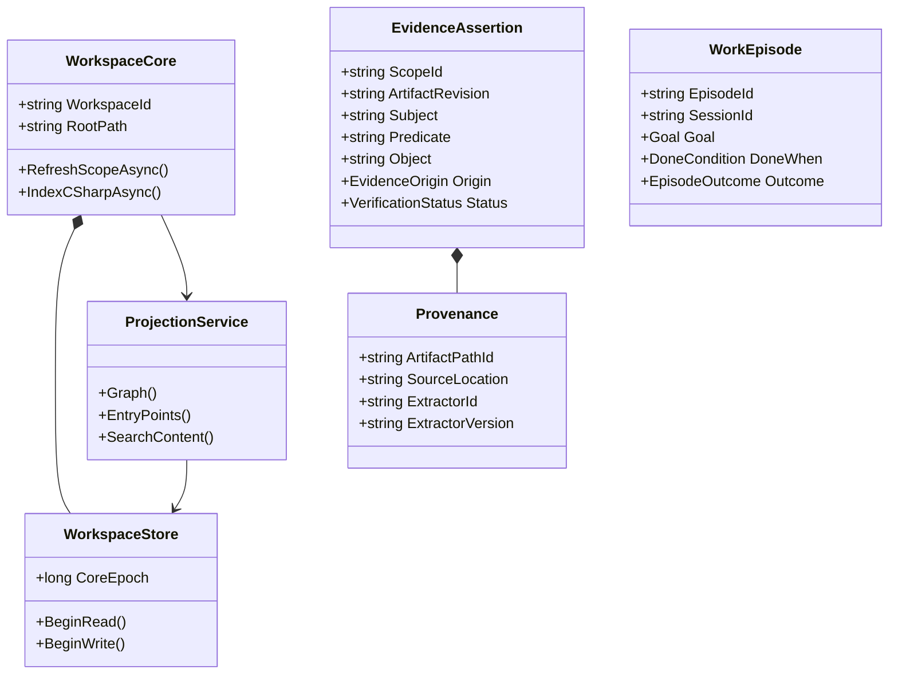

# Recovered class and durable-data model

Current source-level model, **Verified** against `WorkspaceCore`, `EvidenceAssertion`,
`WorkspaceStore`, `ProjectionService` and `WorkEpisode`. This is a selected explanatory slice,
not an exhaustive inventory of public classes. Native class-association inference has the separate
FR-004 ambiguity/ownership caveat.

## Durable grain and history

One fact is one extractor's normalized subject/predicate/object assertion at one artifact revision.
`WorkspaceSchema.cs` contains dimensions (`workspace_dim`, `node_dim`, `session_dim`), append-only
scope/receipt/dispatch/prompt facts and an explicitly rebuildable `claim_current_cache`. Update/delete
triggers protect immutable tables. Scope generation and core epoch gate commits. Separate watcher
observations and session/envelope journals are not merged into the code-fact schema by assumption.

The proposed factory WorkItem/Criterion/Assessment/Decision model is **Inferred future design** in
the proposal, not a recovered class or a new implemented table. Source/test facts do not establish
semantic acceptance solely because they can be linked.
