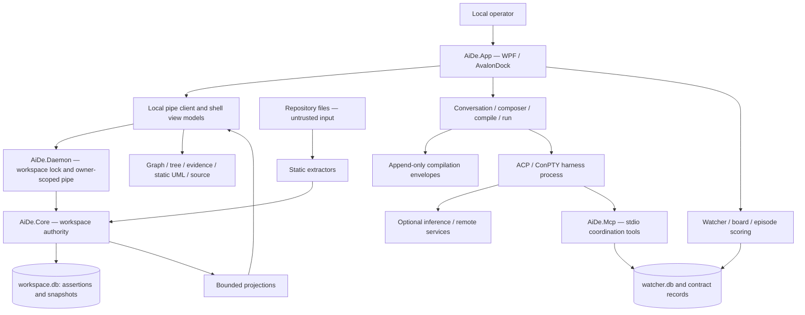

# Recovered component and container map — 2026-10-17

Current composition at `9f13ca7a`, replacing the prior diagram's stale claim that the shell
defaults to in-process Core. Diagram scope is deployable/container and major component boundaries,
not an exhaustive call graph. All solid edges below are **Verified source composition**; provider
network behavior is a boundary whose live policy remains separately qualified.

| Claim | Confidence and observed source |
|---|---|
| Shell's normal daemon path | Verified — `MainWindowViewModel.cs:252`, `ShellBootstrap.ConnectOrLaunchAsync` |
| One workspace authority/store | Verified — `AiDe.Daemon/Program.cs`, `WorkspaceCore.Open`, `WorkspaceStore` |
| Extractor set | Verified — `WorkspaceExtractors.Default`: C#, Python, TypeScript, Bicep, EF, SQL, knowledge plus fixture fallback |
| Native/hosted surface composition | Verified — `SurfaceContentFactory.Kinds` and `WorkbenchShell` selection/query wiring |
| ACP/compile/ConPTY and watcher are distinct paths | Verified — App conductor/session roots and `WatcherHost` |
| Stdio graph gateway availability | Verified distinction — `AiDe.Mcp/Tools.Schema` exposes identity/board/episode, not Core graph tools |
| Provider runtime safety and fidelity | Flagged for version-bound live qualification; local desktop does not mean local inference |

Freshness and byte-bound defects are in FR-001/002. A graph whose source revision is stale is not
promoted to current truth by this diagram. Full user-visible factory/PR/test/risk workflows remain
proposed; see the build inventory rather than extrapolating from a registered control.
