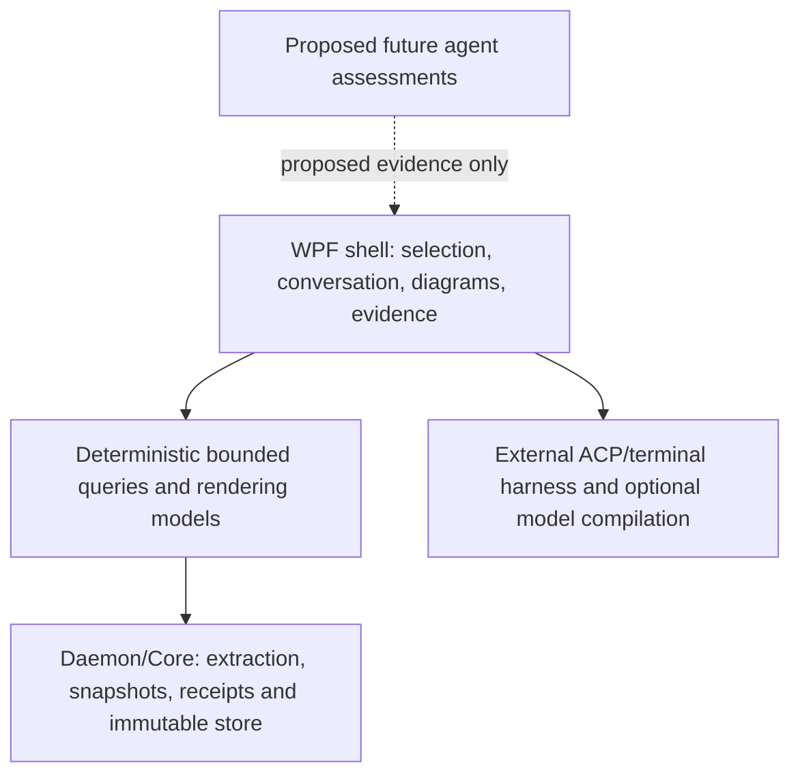

# Recovered capability layers and authority

The diagram separates observed deterministic mechanics from optional model work. **Verified source
composition** at `9f13ca7a`; future factory analysis is a proposal, not a currently shipped tier.

| Layer | Current authority / limitation |
|---|---|
| Local fact authority | Parsed assertions, provenance, scope generations and source identity; FR-001 freshness defect remains |
| Projections / views | Deterministic derived selection with explicit omissions; FR-002 byte enforcement gap remains |
| Agent execution | Operator-selected provider/tool lane; bounded permissions must be qualified for actual offered capabilities |
| Compilation | Deterministic precompile plus optional gated agent call; envelopes retain provenance/history |
| Watcher / proof | Observation, pointers and scoring of bounded signals; not automatic semantic correctness |
| Proposed factory assurance | Agent claims remain assessments; policy and human decisions are separate retained records |

No model-written summary becomes code truth or approval by presentation alone. Do not claim the
entire product is incapable of source changes: agents in execution lanes can edit, while diagram and
source viewers are read-only. Local storage and external inference are independent trust decisions.
