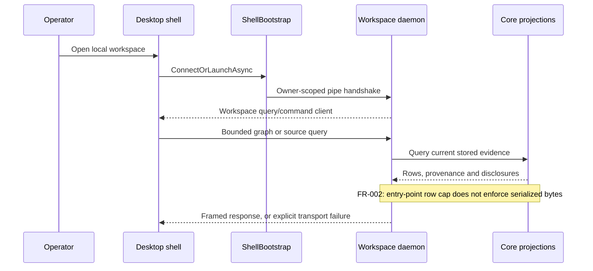
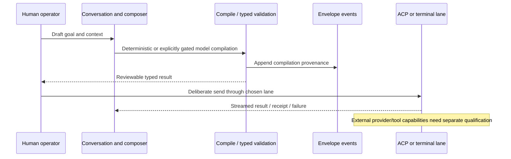

# Recovered sequence paths and failure boundaries

Source-recovered scenarios at `9f13ca7a`. These diagrams describe production control flow,
not a captured runtime trace. **Verified** arrows cite the composition below; defects are drawn
as actual missing protections, not idealized checks.



```mermaid
sequenceDiagram
 participant Repo as Repository content
 participant Index as IndexCSharpAsync
 participant Refresh as RefreshScopeAsync
 participant Store as Snapshot store
 Repo->>Index: Content changed, same supplied revision
 Index->>Index: Fingerprint changed or force=true
 Index->>Refresh: Refresh scope with supplied revision
 Refresh->>Store: Read latest committed revision
 Store-->>Refresh: Same revision, nonempty snapshot
 Refresh-->>Index: Complete, zero assertions (reused)
 Index-->>Repo: Reports scope indexed; old symbol remains
 Note over Repo,Store: FR-001 reproduced; changed-revision control refreshes correctly
```



Sources: `MainWindowViewModel.cs:252`, `WorkspaceCore.cs:154–160,402–498`,
`ProjectionService.cs:704–730`, `EnvelopeStore`, App composer/conductor and `BoundaryDispatcher`.
Two-phase terminal dispatch and ACP streaming have different receipt semantics; no diagram claims
one common exactly-once guarantee. Periodic independent freshness requeue is not composed today.
The product's static sequence viewer draws type-level call-site scenarios; runtime/method-level
causality is still to build. Registration/episode flows are described in the watcher spec and API
bundle; they are not evidence that a session without environment registration is scored.
