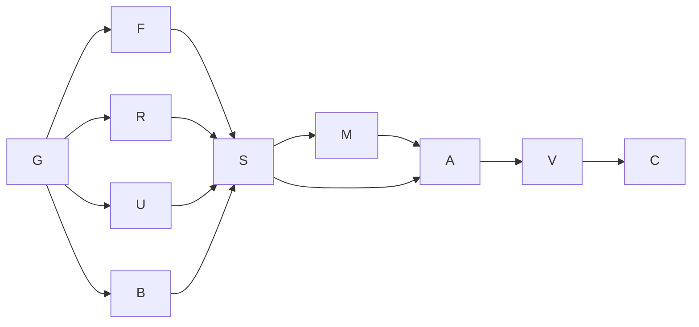

# Goal and execution contract

Goal: fulfill the three requested skills across the whole solution and all five research areas.
Done when the evidence-based review and built inventory, sourced knowledge base, interactive
proposal and new working mockups are saved, linked and checked. The user's clarification is
binding: **AI-DE remains a local desktop workbench**. Production remediation, accepted
requirements and remote publication are outside this exploratory work. Tier T2; fan-out cap 3.

Baseline: `9f13ca7a13c16eb1a7b4e3bd4027c20c640b6545`, branch `main`, dirty working tree.
Existing unrelated file bytes are backed up under the checkout git directory. Root is the sole
working-tree writer. Advisory agents have read-only repository contracts and return evidence;
there is no concurrent checkout writer. The named checkout is the delivery tree (WT1b).
No native deep-research tool is exposed in the active tool inventory; deep research uses
multiple primary-source searches, full-page reads, source cross-checking and counter-evidence.

Grounding traversal: `spec-ai-native-ide → architecture → kb-code-knowledge-graphs` and
the existing shell, graph, diagrams, MCP, observability and operational-test knowledge bases.
The pack's requested `kb-graph-and-loop-engineering` node is absent from this consuming
repo; planning falls back to its installed execution-graph standard instead of inventing a link.
Inventory baseline: 544 artifacts, no metadata errors or orphans, 76 freshness suggestions,
and one derived-index omission from the preceding pack lifecycle evidence.

| Node | Capability | Goal / input | Exit / oracle | Tier | Real dependencies |
|---|---|---|---|---|---|
| G | Reasoning | Compile request, inspect manifests and existing intent | Five topics and six surfaces traced; desktop constraint fixed | T1 | none |
| F | Reasoning | Recover the whole solution from code, tests and docs | Capability inventory and every finding cites a location and disconfirmation | T2 | G (data) |
| R | Reasoning | Review, drift and summarization research | Primary sources opened; limitations and human-review thresholds distinguished from evidence | T2 | G (data) |
| U | Reasoning | Current product UX and local UI comparison | Every named product checked; absent proof marked Flagged | T1 | G (data) |
| B | Deterministic mechanics | Small representative build/test and repository controls | Actual command outcomes, no inferred pass | T0 | G (data) |
| S | Reasoning | Join findings and sources; choose proposal alternatives and UI direction | Distinct alternatives; source/date ledger; domain model before UI | T2 | F,R,U,B (data) |
| M | Reasoning | Build interactive local HTML proposal and six-context mockup | Functional flows and hard states; synthetic data visibly labeled | T1 | S (decision) |
| A | Independent review | Attack findings, sourcing, scope and mockup accessibility | Unsupported claims downgraded; vetoes recorded; author does not self-clear | T2 | S,M (data) |
| V | Deterministic mechanics | Render docs, regenerate graph, validate, snapshot, exercise HTML | Link/metadata gates and interaction probes pass; residuals explicit | T0 | A (decision) |
| C | Reasoning | Audit/change records, evidence handoff and local research commit | All requested deliverables discoverable; no production change | T1 | V (data) |

Naive serial graph: ten nodes, span ten unit-cost nodes. Optimized: ten nodes, width at
most four including coordinator, span seven unit-cost nodes. Inferred equal-node model:
T1=10, T∞=7, p=4 ceiling=7.75; these are structural estimates, not elapsed-time promises.
Deterministic share 2/10; no rigor floor removed. Removing incidental ordering between
forensics, research and baseline verification shortens the chain; design still waits for evidence.

Advisory fan-out: at most three agents, at most 35 calls each on the initial pass. Retry a
transient web failure once; inaccessible pages become explicit gaps. Join requires all assigned
questions covered, not unanimity. Returned facts remain leads until the coordinator inspects
the supporting files or sources. Partial branches cannot silently erase a named product or topic.
No agent may modify production, docs, configuration, dependencies, schemas, CI or git state.
The later independent reviewer checks claims and rendered mockups rather than authoring them.

Research variant: unanswered assigned questions decreases to zero; no endless source accumulation.
Finding variant: unsupported or duplicate findings decreases to zero, with disputed items flagged.
Mockup variant: unexercised required interactions/states decreases to zero. Two correction passes
are the circuit breaker; firing it is a defect signal and yields an explicit unresolved issue.
Checkpoints: native capability inventory; build failure; missing human-review evidence; local
versus browser preference (resolved desktop); adversarial veto; graph or interaction failure.

Surface list: specs/ADRs/mockups → production contracts/readers → tests/proofs → finding and
capability rows → research claims → proposed evidence model → six UI contexts → HTML controls →
review outcomes → indexed artifacts. A coverage percentage is never semantic coverage, an
extracted edge is never a specification assertion, and a mockup is never native WPF proof.

## Cost and delivery ledger

Executed the ten-node base graph with three advisory agents and one checkout writer. The user's
authoring addition was appended at the completed review checkpoint as four bounded nodes: inspect
current authoring, model draft/history boundaries, build the editor/stack exploration, independently
review and verify it. Tier T2 and fan-out3 did not change. The PR-question addition refined Review.

Observed delivery: 49 high-level inventory rows plus17 nested authoring details;11 deduplicated
proposed findings;8 knowledge files and42 primary-source entries/supplements; an interactive
proposal and embedded/standalone mockup. Four primary assemblies build;57 selected Core tests pass;
two adverse forensic reproductions are retained;12 browser regressions pass. Graph sweep:
562 artifacts,0 defects/orphans/index drift,124 freshness suggestions. Two Minor compact-typography
craft suggestions remain, with no blocking token/accessibility findings.

Rework was recorded rather than hidden: source/path and contract amendments; initial diagram/focus/
question-state corrections; the reproduced preview/apply mismatch and its shared-match repair;
deterministic browser-fixture initialization; and seven invalid relation labels corrected after
the graph validator rejected them. Per-skill audit markers measure elapsed invocation windows;
these overlap and must not be summed as execution cost. Token/provider cost is not exposed or
invented. No provider call, production change, remote issue or remote publication occurred.
