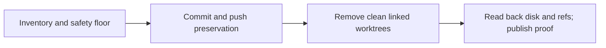

Goal: commit and push remaining work, then leave only `C:/Projects/ai-de` locally.
Done when main matches origin, every removed tree's commits and uncommitted work have remote recovery references, Git lists one tree, and sibling worktree directories are absent. Do not merge divergent historical branches or delete the primary checkout. Tier T2; agent fan-out zero.

The compiled request maps “commit and push all” to preservation of main changes, historical tracked changes and untracked evidence; “only thing left locally is the local checkout” maps to removal of registered trees and relocation of orphan evidence inside the primary checkout.

Grounding reference: the installed `optimize-graph` skill and `.claude/knowledge/execution-graph-optimization.md`. Its named `kb-graph-and-loop-engineering` knowledge node is absent in this consuming repository, so the plan links to the existing knowledge hub rather than creating a dangling graph edge.

| Node | Capability | Inputs | Exit / oracle | Dependencies | Tier |
|---|---|---|---|---|---|
| Inventory | Deterministic mechanics | Git inventory, session holds, disk | Every linked tree has status and remote containment; active hold blocks removal | None | T0 |
| Preserve | Deterministic mechanics | Inventory | New files archived with hashes, tracked changes committed, remote refs verified | Inventory (data) | T0 |
| Remove | Deterministic mechanics | Verified recovery refs | Clean, unheld trees removed by coordination cleanup; primary excluded | Preserve (safety decision) | T0 |
| Verify and publish | Deterministic mechanics | Disk and Git readback | One registered tree, no sibling worktree directories, clean main equals remote | Remove (data) | T0 |

Safety floors are immovable: primary/current directory exclusion, clean status, remote preservation, no live holds, resolved-path checks before deletion, and disk readback after Git removal. Surface list: file content → Git index/object → remote ref → worktree registration → physical directory → cleanup proof. Scope of sibling scan: direct children of `C:/Projects`, names starting `ai-de-`, confirmed by the initial worktree inventory or evidence-only inspection. No unrelated repository is eligible.

Naive and optimized shapes both have four dependent phases, modeled work 4 and span 4 equal phase units (Inferred; not duration estimates). Width 1; all mechanical steps deterministic. Parallel mutation would contend on shared refs and coordination logs. Loops process a finite inventory: remaining unchecked/preserved/removed trees strictly decreases to zero; ceiling is the initial inventory count, and a refusal stops that item for investigation rather than discarding it. Budget: one inventory, one preservation per dirty tree, one cleanup, readback; any failure retains data and is reported. Re-plan at preservation volume, push failure, live hold, or surviving directory.

Adversarial checks: remote containment alone does not prove dirty files preserved; archives and content hashes provide that evidence. Git removal exit status alone does not prove disk absence; direct filesystem checks provide it. A pushed preservation branch is recovery evidence, not acceptance of its code. Existing generated evidence will be archived rather than mixed into main source.

Actual measurements and recovery refs are recorded in the sibling cleanup proof at completion. Tokens and spend are not exposed by this runner and will be reported as not recorded.
