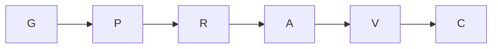

# Revision 97 to 102 installation

Request: `$updatepack`. Session: `codex-updatepack-20261017`.

Goal: refresh the existing installation from `C:/Projects/ai-forward`.
Done when revision 102 is installed, local additions survive, conflict staging is empty,
and the doctor, marker scan and relevant repository controls have been read.
Not in scope: product changes, commits, pushes, personal trust settings or model changes.
Tier T1; agent fan-out 0. Coordinator seat; persona lenses enacted in separate passes.

## Grounding and plan

Verified: installed revision 97; source revision 102, bundle `2026.10.14.2`, source
commit `0900e78`. The target already contains uncommitted changes, including its
revision-97 installation. Those changes are not a clean baseline to reset.
The source applier resolves revision 97 to `648f8f0e0f12a0c59ee51c6f473f11837f85be11`.
Pre-update hashes and conflict originals are retained in the checkout's git directory.
Existing session cards are dated September; no current overlapping writer is identified.
The named checkout is the delivery destination (WT1b).

Compiled scope: apply the local source's deployment map, preserve target deviations,
run its required checks, report the action table and offer a commit. No open decision request.

Surface list: source manifest → deployment map → knowledge and skill copies on every
harness → scripts and hook dispatch → native hook settings → managed front doors →
context baselines → installation readers. No domain aggregate, product schema or UI changes.

| Node | Capability | Inputs and goal | Exit condition | Tier | Dependency |
|---|---|---|---|---|---|
| G | Reasoning | Revisions, history, ownership, deviation note; fix scope | Delta and exclusions known | T1 | none |
| P | Deterministic mechanics | Source applier preview; identify affected paths | Every row classified | T0 | G (data) |
| R | Reasoning | Revision-97 base, current bytes, source bytes; decide conflicts | Every local addition accounted for | T1 | P (decision) |
| A | Deterministic mechanics | Source applier and reconciliation decisions | Update applied; parked conflicts resolved | T0 | R (decision) |
| V | Deterministic mechanics | Installed bytes; doctor, marker scan, repository controls | Results read; residuals stated | T0 | A (data) |
| C | Reasoning | Results and preserved hashes | Evidence, audit and commit offer recorded | T1 | V (data) |

All gates are immovable. Baseline and optimized graph both have six nodes and width one;
no new handoff earns its cost. Inferred unit-cost model: T1 = 6, span = 6,
T_p ceiling at p=1 = 6; these are structural units, not measured seconds.
The shared checkout makes apply and verify sequential. Independent read-only inspections
may be batched. No concurrent agent exploration is needed. Deterministic share: 3/6 nodes.
Conflict reconciliation has variant unresolved files, floor zero, exit zero unresolved;
cap six original conflicts, with any new conflict reopening R rather than being ignored.
Budget: the five-revision deployment delta and its checks; a blocked gate is reported,
never dropped. Checkpoints: plan conflicts, apply errors, verification failures.

Adversary passes: Release Engineer requires old text to survive or be explicitly subsumed;
Documentation Steward requires both knowledge copies to agree and the Docs Explorer bytes
to remain unchanged; Tech Lead excludes product edits; Test Architect requires executable
checks of the retained audit extension. The Simplifier rejects a full product build for a
pack installation. Runtime qualification of every host is outside this installation check.

## Conflict decisions made before apply

| Destination | Local difference from revision 97 | Resolution |
|---|---|---|
| Both `audit-and-change-log.md` copies | AL0.2 opt-in and git identity rule | Source 102 contains these rules and adds fallback JSONL-only behavior; preserve with source text |
| `scripts/audit-log.py` | Opt-in default plus `append --supersedes` | Source contains opt-in; retain both supersedes CLI and record field on top of source |
| `scripts/coord-runner.py` | Slow leader-check retries | Source contains the same behavior and replaces the measured failing fixed retry budget with lease-bound housekeeping |
| `scripts/pack-apply.py` | Explorer opt-in, git identity hook and worktree wording | All are present in source 102, together with dispatcher and Muse support |
| `hooks/README.md` | Git identity hook documentation | Present in source 102; keep updated dispatcher documentation as well |

The recorded `.gitignore` deviations stay in place. Agent prompt deviations and the
repository's session-start checks, coordination core and conductor join are three-way merged.
No separate deviation test/register was found by filename search; the accepted gitignore
decision note is the durable deviation record. The audit extension is checked explicitly.

## Results

Verified:

- Installed revision 102, bundle `2026.10.14.2`; all six parked conflicts reconciled.
- `pack-doctor.py`: **0 FAIL, 4 WARN, 20 PASS**. The warnings are the Windows
  `python3` alias (all commands used working `python`), personal Copilot
  `long_context`/global-high-effort settings (a per-session choice), existing stale or
  review-suggested graph nodes, and 311 legacy requests without deadline/fallback.
- `tools/test-pack-deviations.py`: **4 tests passed**. Checks the retained audit
  supersedes field, append-only history, JSONL-only fallback, removal of absorbed native
  hook registrations, and identity-write refusal through three dispatchers.
- Red first: the native-registration check failed on all three affected hook files.
  Their text merge had retained a standalone identity guard beside the dispatcher.
  Those registrations were removed; the dispatcher still refused identity writes with
  exit 2 for Claude, Grok and Copilot. No git identity was set.
- `verify-audit-log.py`, `verify-audit-capture.py`, `verify-capture-instruction.py`,
  `verify-defect-register.py` and the conflict-marker scan passed.
- Context-budget `gate`, `prefix --gate` and `skills --gate` passed after all merges.
- `coord install` ran in the primary checkout, refreshed its pre-commit hook and added
  the staged-conflict guard at pre-merge-commit. `.gitattributes` was already correct
  and remained unchanged. `coord doctor`: 11 patterns, effective registered drivers,
  no overlapping leases; no register entry needed reclassification.
- A repeated source apply changed zero bytes across 2,646 existing repository files.
  No file remains in conflict staging. No retired backup was created by this update.
- Exactly one managed block remains in each front door. The existing `CLAUDE.md`
  uses the source installer's `# CLAUDE.md` heading followed by `@AGENTS.md`; no
  conversion or paragraph relocation was necessary.
- No product, test-suite or site file was changed. The only new test is the pack
  deviation control. The pre-existing `.gitignore` decisions are preserved.

The initial checkout already had `docs/docs-index.js` in its git diff. Comparing
against HEAD would therefore misattribute that change to this update. Its SHA-256 is
unchanged from the pre-update capture:
`ced60f5a0cab32920b9be79027acbcbaa5a0dfa3bec92dc894b7d24ee3285d81`.
`docs/index.html`, `docs/_meta.json`, `docs/_site/index.html` and `.gitignore` also
retained their pre-update bytes.

Residuals: doctor reports historical graph/request debt, and coordination reports six
owed derived artifacts, including the protected Docs Explorer index. This installation
does not regenerate them. Live lifecycle enforcement is not newly qualified: the doctor
executed the launcher probe, but reports doorbells and heartbeat as not recorded.
Muse support is a repository surface check; its live catalog was not queried. No new skill
or domain knowledge document was added by the 97→102 delta; `muse-surface.md` and
`hooks/dispatch.py` are new.

The environment supplied neither `AIDE_SESSION` nor `AIDE_CONTRACT_LOG`. No application
registration or scored episode close is claimed. This proof is named in both durable
skill audit entries so its verification path remains available.

## Corrections and cost ledger

The graph validator caught a missing `summary` in this proof; it was supplied and the
doctor then passed. That recurrence and the dispatcher merge class are recorded in the
defect register with their executable controls. Temporary verification fixtures were
corrected for required CLI fields, source hook-path mapping, the source-generated import
heading, and file-versus-directory enumeration; those did not change product behavior.
The lease command refused a claim over its own `.agents/` substrate; those paths were
excluded from leases rather than bypassing that guard.

Planned versus actual: six logical nodes, width one, zero delegated agents in both.
Seven local correction passes were observed (diagnostic mapping, substrate lease,
proof metadata, dispatcher merge, audit fixture, import assertion, directory assertion).
Actual wall time is measured by the audit start/append markers; token cost is not
recorded by this runner. No completeness gate was dropped. No product build was needed
because no product source changed. New human-readable evidence gets an HTML companion;
the lifecycle exemption keeps the Docs Explorer index untouched.

## Original application action table

The six FAIL rows below are the applier's original parking report, before the explicit
reconciliation above. They are retained as evidence, not presented as unresolved failures.

pack-apply apply: source revision 102, target revision 97
| Area | Artifact | Action | Status | Note |
|---|---|---|---|---|
| knowledge | `.claude/knowledge/audit-and-change-log.md` | CONFLICT | FAIL | repo-local changes could not be merged; new pack text at docs/ai-forward-pack/conflicts/.claude/knowledge/audit-and-change-log.md - reconcile, then delete it |
| knowledge | `.github/knowledge/audit-and-change-log.md` | CONFLICT | FAIL | repo-local changes could not be merged; new pack text at docs/ai-forward-pack/conflicts/.github/knowledge/audit-and-change-log.md - reconcile, then delete it |
| skills | `.claude/skills/execute-with-coordination/reference/launch.md` | UPDATE | OK |  |
| skills | `.grok/skills/execute-with-coordination/reference/launch.md` | UPDATE | OK |  |
| skills | `.agents/skills/execute-with-coordination/reference/launch.md` | UPDATE | OK |  |
| skills | `.github/prompts/execute-with-coordination.prompt.md` | UPDATE | OK |  |
| bundle | `docs/ai-forward-pack/muse-surface.md` | ADD | OK |  |
| agents | `.claude/agents/csharp-developer_agent.md` | MERGE | OK | repo-local deviation carried over (three-way merge) |
| agents | `.claude/agents/distributed-systems-architect_agent.md` | MERGE | OK | repo-local deviation carried over (three-way merge) |
| agents | `.claude/agents/enterprise-architect_agent.md` | MERGE | OK | repo-local deviation carried over (three-way merge) |
| agents | `.claude/agents/patterns-expert_agent.md` | MERGE | OK | repo-local deviation carried over (three-way merge) |
| agents | `.claude/agents/python-developer_agent.md` | MERGE | OK | repo-local deviation carried over (three-way merge) |
| agents | `.claude/agents/rust-developer_agent.md` | MERGE | OK | repo-local deviation carried over (three-way merge) |
| agents | `.claude/agents/security-identity-architect_agent.md` | MERGE | OK | repo-local deviation carried over (three-way merge) |
| agents | `.claude/agents/sre-diagnostician_agent.md` | MERGE | OK | repo-local deviation carried over (three-way merge) |
| agents | `.claude/agents/tech-lead_agent.md` | MERGE | OK | repo-local deviation carried over (three-way merge) |
| agents | `.claude/agents/test-architect_agent.md` | MERGE | OK | repo-local deviation carried over (three-way merge) |
| agents | `.claude/agents/the-simplifier_agent.md` | MERGE | OK | repo-local deviation carried over (three-way merge) |
| bundle | `docs/ai-forward-pack/scripts/audit-log.py` | CONFLICT | FAIL | repo-local changes could not be merged; new pack text at docs/ai-forward-pack/conflicts/docs/ai-forward-pack/scripts/audit-log.py - reconcile, then delete it |
| bundle | `docs/ai-forward-pack/scripts/conductor-join.py` | MERGE | OK | repo-local deviation carried over (three-way merge) |
| bundle | `docs/ai-forward-pack/scripts/coord-core.py` | MERGE | OK | repo-local deviation carried over (three-way merge) |
| bundle | `docs/ai-forward-pack/scripts/coord-runner.py` | CONFLICT | FAIL | repo-local changes could not be merged; new pack text at docs/ai-forward-pack/conflicts/docs/ai-forward-pack/scripts/coord-runner.py - reconcile, then delete it |
| bundle | `docs/ai-forward-pack/scripts/coord_transport.py` | UPDATE | OK |  |
| bundle | `docs/ai-forward-pack/scripts/pack-apply.py` | CONFLICT | FAIL | repo-local changes could not be merged; new pack text at docs/ai-forward-pack/conflicts/docs/ai-forward-pack/scripts/pack-apply.py - reconcile, then delete it |
| bundle | `docs/ai-forward-pack/scripts/pack-doctor.py` | UPDATE | OK |  |
| bundle | `docs/ai-forward-pack/scripts/verify-no-machine-paths.py` | UPDATE | OK |  |
| bundle | `docs/ai-forward-pack/context-budget.json` | MERGE | OK | repo-local deviation carried over (three-way merge) |
| hooks | `docs/ai-forward-pack/hooks/dispatch.py` | ADD | OK |  |
| hooks | `docs/ai-forward-pack/hooks/session-start.py` | MERGE | OK | repo-local deviation carried over (three-way merge) |
| hooks | `docs/ai-forward-pack/hooks/mail-doorbell.py` | UPDATE | OK |  |
| hooks | `docs/ai-forward-pack/hooks/heartbeat.py` | UPDATE | OK |  |
| hooks | `docs/ai-forward-pack/hooks/owner-review-gate.py` | UPDATE | OK |  |
| hooks | `docs/ai-forward-pack/hooks/run-hook.sh` | UPDATE | OK |  |
| hooks | `docs/ai-forward-pack/hooks/copilot.ai-forward-hooks.json` | MERGE | OK | repo-local deviation carried over (three-way merge) |
| hooks | `docs/ai-forward-pack/hooks/README.md` | CONFLICT | FAIL | repo-local changes could not be merged; new pack text at docs/ai-forward-pack/conflicts/docs/ai-forward-pack/hooks/README.md - reconcile, then delete it |
| hooks | `.github/hooks/ai-forward.json` | MERGE | OK | repo-local deviation carried over (three-way merge) |
| hooks | `.grok/hooks/ai-forward.json` | MERGE | OK | repo-local deviation carried over (three-way merge) |
| hooks | `.agents/hooks.json` | MERGE | OK |  |
| hooks | `.grok/rules/grok-surface.md` | UPDATE | OK |  |
| hooks | `.agents/rules/agy-surface.md` | UPDATE | OK |  |
| hooks | `.claude/settings.json` | MERGE | OK | exact shipped hooks refreshed; custom hooks and settings retained; BOM-free UTF-8 |
| bundle | `.gitignore` | KEEP | OK | withheld `spikes/`: the repo records `# pack-apply: decline spikes/` |
| bundle | `.gitignore` | KEEP | OK | withheld `.agents/*`: the repo tracks 433 file(s) under .agents/ beyond the registry, so it commits its per-run records; this blanket would leave those tracked and hide every NEW one, with no signature |
| bundle | `.gitignore` | KEEP | OK | withheld `!.agents/artifacts.yml`: its blanket `.agents/*` was withheld, so it would negate nothing |
| bundle | `.editorconfig` | SKIP | OK | exists - never overwritten |
| bundle | `docs/index.html` | SKIP | OK | exists - never overwritten |
| bundle | `docs/docs-index.js` | SKIP | OK | never created or overwritten (V10) |
| front-doors | `AGENTS.md` | UPDATE | OK | managed block re-pasted wholesale |
| meta | `docs/ai-forward-pack/INSTALL.md` | UPDATE | OK | revision 97 -> 102 |
| meta | `context-budget gate` | BASELINE | OK | Commit it with the change that caused the growth — that diff IS the control. |
| meta | `context-budget prefix` | BASELINE | OK | prefix baseline updated to ~93,430 in C:\Projects\ai-de\docs\ai-forward-pack\context-budget.json |
| meta | `context-budget skills` | BASELINE | OK | skills baseline updated in C:\Projects\ai-de\docs\ai-forward-pack\context-budget.json |

405 UNCHANGED, 20 MERGE, 15 UPDATE, 6 CONFLICT, 3 KEEP, 3 SKIP, 3 BASELINE, 2 ADD

## Final applier action table

After reconciliation, the source applier reports:

pack-apply apply: source revision 102, target revision 102
| Area | Artifact | Action | Status | Note |
|---|---|---|---|---|
| agents | `.claude/agents/csharp-developer_agent.md` | KEEP | OK | repo-local deviation over an unchanged pack file |
| agents | `.claude/agents/distributed-systems-architect_agent.md` | KEEP | OK | repo-local deviation over an unchanged pack file |
| agents | `.claude/agents/enterprise-architect_agent.md` | KEEP | OK | repo-local deviation over an unchanged pack file |
| agents | `.claude/agents/patterns-expert_agent.md` | KEEP | OK | repo-local deviation over an unchanged pack file |
| agents | `.claude/agents/python-developer_agent.md` | KEEP | OK | repo-local deviation over an unchanged pack file |
| agents | `.claude/agents/rust-developer_agent.md` | KEEP | OK | repo-local deviation over an unchanged pack file |
| agents | `.claude/agents/security-identity-architect_agent.md` | KEEP | OK | repo-local deviation over an unchanged pack file |
| agents | `.claude/agents/sre-diagnostician_agent.md` | KEEP | OK | repo-local deviation over an unchanged pack file |
| agents | `.claude/agents/tech-lead_agent.md` | KEEP | OK | repo-local deviation over an unchanged pack file |
| agents | `.claude/agents/test-architect_agent.md` | KEEP | OK | repo-local deviation over an unchanged pack file |
| agents | `.claude/agents/the-simplifier_agent.md` | KEEP | OK | repo-local deviation over an unchanged pack file |
| bundle | `docs/ai-forward-pack/scripts/audit-log.py` | KEEP | OK | repo-local deviation over an unchanged pack file |
| bundle | `docs/ai-forward-pack/scripts/conductor-join.py` | KEEP | OK | repo-local deviation over an unchanged pack file |
| bundle | `docs/ai-forward-pack/scripts/coord-core.py` | KEEP | OK | repo-local deviation over an unchanged pack file |
| bundle | `docs/ai-forward-pack/context-budget.json` | KEEP | OK | repo-local deviation over an unchanged pack file |
| bundle | `.gitignore` | KEEP | OK | withheld `spikes/`: the repo records `# pack-apply: decline spikes/` |
| bundle | `.gitignore` | KEEP | OK | withheld `.agents/*`: the repo tracks 433 file(s) under .agents/ beyond the registry, so it commits its per-run records; this blanket would leave those tracked and hide every NEW one, with no signature |
| bundle | `.gitignore` | KEEP | OK | withheld `!.agents/artifacts.yml`: its blanket `.agents/*` was withheld, so it would negate nothing |
| bundle | `.editorconfig` | SKIP | OK | exists - never overwritten |
| bundle | `docs/index.html` | SKIP | OK | exists - never overwritten |
| bundle | `docs/docs-index.js` | SKIP | OK | never created or overwritten (V10) |
| meta | `context-budget gate` | BASELINE | OK | Commit it with the change that caused the growth — that diff IS the control. |
| meta | `context-budget prefix` | BASELINE | OK | prefix baseline updated to ~93,430 in C:\Projects\ai-de\docs\ai-forward-pack\context-budget.json |
| meta | `context-budget skills` | BASELINE | OK | skills baseline updated in C:\Projects\ai-de\docs\ai-forward-pack\context-budget.json |

434 UNCHANGED, 18 KEEP, 3 SKIP, 3 BASELINE

This is a pack lifecycle record. The updatepack exemption keeps `docs/docs-index.js`
unchanged; no docs graph regeneration is run.

## Publication authorization

The user approved: `yes stage, commit and push`.
The publication path is stage the managed deployment manifest and this update's evidence,
commit with `chore: update AI-Forward Pack to revision 102 (2026.10.14.2)`, then push
`main` and compare the remote ref with the resulting local commit. These are three
sequential nodes; the normal pre-commit hook is retained. Agent fan-out remains zero.

Before staging, fetch identified one incoming commit, `0a9dad68`, changing only five
GitHub Actions workflows to manual dispatch. It does not overlap the update; `main`
was fast-forwarded to it. The already-present revision-97 installation changes belong
in the same pack publication so that the committed installation is complete. Existing
changes to `site/`, `docs/docs-index.js`, `docs/_meta.json` and `docs/_site/index.html`
remain outside the staged scope. This section records authorization and preparation;
the resulting Git commit and remote ref are the publication receipt.

Staging selected 296 managed pack and evidence files. The conflict-marker scan read
2,652 tracked text files after staging and passed; all four pack deviation tests passed.
`git diff --cached --check` named two trailing spaces at line 90 of the new
`.agents/skills/adddomainexperts/SKILL.md` and `.grok/skills/adddomainexperts/SKILL.md`.
Both reproduce the source command's existing `**A CFD project.** ` line verbatim,
also present in the already-installed Claude copy. They are recorded source formatting,
not silently presented as a clean whitespace check.
