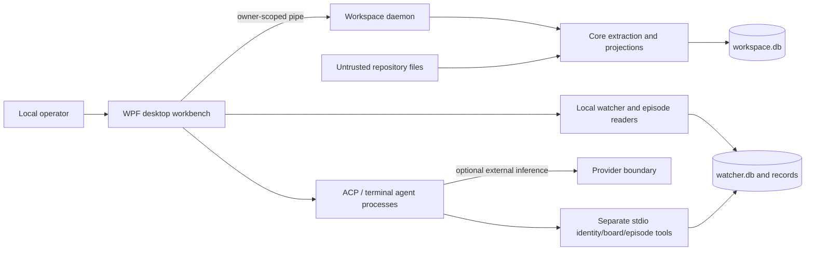

# Whole-solution forensic review

## Verdict and baseline

**Readiness verdict: BLOCK on trusting the workbench as sole current-change assurance.**
Two focused probes reproduced graph freshness and response-bound defects. A successful build and
57 selected tests are useful baseline evidence, not full product/native/security/release readiness.
No P0 exploit, active data loss or safety incident was demonstrated. No production remediation was
performed; the backlog is proposed for human triage. The separately requested research/proposal
continues without treating triage as permission to implement.

Reviewed commit: `9f13ca7a13c16eb1a7b4e3bd4027c20c640b6545`, branch `main`, dirty worktree.
Existing site and generated-document changes were captured before this work; regenerated derived
documentation is a new authorized output. Source/dependency/schema/runtime/CI bytes are not changed.

| Baseline command | Observed outcome | What it does not prove |
|---|---|---|
| `dotnet build src/AiDe.App/AiDe.App.csproj --no-restore --configuration Debug --verbosity minimal` | Four primary assemblies built; 0 warnings/errors | Packaged/native/runtime correctness |
| Selected Core `dotnet test` with BoundaryDispatchTests, CallEdgeTests, TheProjectionIsTheOneProducerTests, EntryPointsProjection filter | 57 passed, 0 failed/skipped | Entire test suite, coverage or mutation strength |
| `dotnet list AiDe.sln package --vulnerable --include-transitive --no-restore` | No vulnerable packages reported from current NuGet/local sources | Undisclosed vulnerabilities, JS assets, policy or reproducibility |
| Audit and capture-instruction verifiers | Passed | App episode registration in this harness |
| Retained forensic probe | Dirty edit stayed stale; entry-point payload exceeded frame | No production repair or full exploit demonstration |

The native App suite was not run because this review did not claim desktop UI qualification or
take control of the operator's desktop. Release/package recovery and live provider adapters were
not exercised. The existing workflows are manual-only by an explicit prior commit; this review
does not change that choice or claim a fresh GitHub CI run.

## Recovered system map

Verified composition: WPF/AvalonDock App → owner-authenticated local named pipe → per-workspace
Daemon → Core indexing/store/projection authority. App also hosts ACP conversations, ConPTY and
local watcher surfaces. Separate stdio MCP exposes identity/board/episode tools, not the internal
Core graph gateway. Source roots: `MainWindowViewModel.cs:252`, `AiDe.Daemon/Program.cs:49,182`,
`WorkspaceCore.cs:75`, `AiDe.Mcp/Tools.cs:22`.

Facts are versioned assertions with provenance and scope/generation guards. Session configs/events
and compilation envelopes are distinct repository artifacts; user layout is preference state.
Trust boundaries include untrusted repo/XML/HTML, the local IPC peer, external harnesses/providers,
MCP/connector capabilities and forgeable observation records. C# project files are deliberately read
as data rather than executing repository build targets; the knowledge HTML reader disables script
and navigation. These are located controls, not proof that all boundary attacks were tested here.

## Architecture, design, implementation and traceability

The strongest reusable architecture is already present: local authority, durable facts, bounded
queries, typed compilation, receipts, worktree/session infrastructure and evidence navigation.
The factory request extends the domain with accepted obligations, change/assessment snapshots and
human decisions. Do not build a second graph/store or treat the current session UI as only a CLI.

Architecture risks cluster around freshness/integration boundaries and observable authority.
Design risks include item-count versus byte bounds, simple-name versus stable identity, and labels
such as read-only exceeding qualified tool capabilities. Implementation issues include failed-import
retry state. Release reproducibility is distinct from current advisory results. Current documentation
has real contradictions; deliberately historical architecture text remains historical, not false intent.

Trace chain: existing typed document links and code facts do not establish that every criterion has a
meaningful test oracle. Present tests prove selected mechanics; they do not constitute a semantic
spec/code/test drift engine. The built/remaining inventory makes this scope boundary explicit.

| Lens | Review disposition |
|---|---|
| Architecture/data/dependency direction | Reviewed composition, durable stores and APIs; query/freshness gaps retained |
| Security/identity/privacy | Reviewed source boundaries and declared connector residual; no exploit claimed |
| Concurrency/distribution | Reviewed single-writer generations, daemon/pipe and dispatch receipts; no stress test |
| Testing/fidelity/mutation | 57-test baseline and two focused probes; full suite/coverage/mutation not run |
| Reliability/observability/performance | Freshness, import recovery, activities and bounds reviewed; no scale budget verified |
| Accessibility/UX | Current source/mockups inventoried; native UIA/DPI/keyboard readiness unverified |
| Supply chain/release | Current NuGet query plus lock/pin contract mismatch; no full JS/SBOM/package audit |
| Documentation/traceability | Composition contradictions corrected in docs; semantic assurance remains future work |

## Deduplicated findings

### FR-001 — Dirty edits can survive forced reindex as old graph evidence

P1 · **issue** · freshness · **Verified executed**.
Location: `src/AiDe.Core/WorkspaceCore.cs:154–160,445–498; WorkbenchShell.cs:697,791–794`.
Observed: Same-revision force:true reported ScopesIndexed=1, Assertions=0 and kept Probe.BeforeEdit after the file became AfterEdit. A changed-revision control emitted AfterEdit.
Consequence: Graph, summaries and reviews can describe old source while reporting successful indexing.
Disconfirming check: Compared both fingerprint and revision reuse layers; executed same-revision and changed-revision Core controls.
Contract: Spec US-1 fresh, provenance-bearing architecture inspection; WorkspaceCore refresh promises a current scope snapshot. The executed oracle is same supplied revision, not a Git/shell run.

### FR-002 — Entry-point results can exceed the IPC frame despite row clamping

P1 · **issue** · resource bounds · **Verified executed**.
Location: `src/AiDe.Core/Projections/ProjectionService.cs:704–730; EntryPointsProjection.cs:62–70; EveryOperationFitsTheFrameTests.cs:50–51`.
Observed: 1,300 facts with 2,000-character identifiers return 1,254 rows and serialize to 5,165,696 bytes against a 1,048,576-byte frame.
Consequence: Large/hostile repository content can make a normal read untransportable.
Disconfirming check: Inspected final return path and measured Web-default JSON payload using the same serializer family as the existing frame oracle.
Contract: IpcFraming.MaxFrameBytes and ProjectionService.MaxResponseBytes are byte contracts; EntryPointsProjection itself documents that a row count is not a byte bound.

### FR-003 — Independent freshness detector is not composed on the production path

P2 · **issue** · reliability · **Verified static**.
Location: `src/AiDe.Core/Health/FreshnessProber.cs:24,34; docs/architecture.md former current component description`.
Observed: Only declaration, tests and explanatory comments reference FreshnessProber; no production instantiation or call found.
Consequence: Lost watcher signals lack the independent detection promised by current documentation.
Disconfirming check: Global source type/call search; checked existing WalkingSkeletonTests which construct their own prober.
Contract: The architecture component contract requires periodic independent revision probing and re-enqueue; FreshnessProber implements the primitive but is not composed.

### FR-004 — Simple-name association inference can select an ambiguous type

P2 · **risk** · diagram integrity · **Verified algorithm; inferred consequence**.
Location: `src/AiDe.App/Workbench/ClassHierarchyModel.cs:183–208`.
Observed: The association lookup overwrites entries keyed by simplified labels; collections are drawn as aggregation without an ownership proof.
Consequence: A diagram may imply a wrong relation or stronger ownership than extracted evidence supports.
Disconfirming check: Read derivation and available association tests; no duplicate-qualified-name oracle found.
Contract: The UML/ERM specification requires derived relationships, evidence status and unresolved/inferred disclosure; simplified labels do not establish qualified identity or ownership.

### FR-005 — Core query and indexing activities lack a normal retained sink

P2 · **risk** · observability · **Verified composition gap; inferred runtime visibility**.
Location: `src/AiDe.Core/WorkspaceCore.cs:19; ProjectionService.cs; production ActivityListener search`.
Observed: Existing listeners are narrow terminal/composition/disposal ledgers; test-only telemetry listeners establish emission, not deployed retention.
Consequence: Operators may not answer query/index latency, volume and failure questions after normal usage.
Disconfirming check: Searched ActivityListener, OpenTelemetry/exporter composition; acknowledged existing durable UI diagnostics.
Contract: Instrumentation-over-inference IO1/IO2/IO6 requires normal-path measurement of latency, volume and failure, not test-listener-only evidence.

### FR-006 — Failed episode import is marked complete before import succeeds

P2 · **issue** · recovery · **Verified static control flow**.
Location: `src/AiDe.App/Workbench/WorkbenchShell.cs:2895–2897,2940`.
Observed: _episodesImported is set before ImportAndScoreEpisodesFromAuditLog; the outer catch does not clear it.
Consequence: A transient first import failure can leave that attach missing episode evidence.
Disconfirming check: Read import block, catch and reattach reset sites; no same-attach retry state found.
Contract: The watcher import guard represents completion for one attach; a thrown import has not completed. Reliability/failure-disposition and IO measurement obligations require observable recovery.

### FR-007 — Read-only ACP label does not cover all settings-loaded tools

P2 · **risk** · security and privacy · **Verified documented residual**.
Location: `src/AiDe.App/Conductor/GovernedRunHost.cs:88–95`.
Observed: The code explicitly names mcp__* tools/connectors outside built-in denies; settings/hook behavior is a separate boundary.
Consequence: Read-only analysis can have a broader effective capability set than the user expects.
Disconfirming check: Read options and compile-lane distinctions; no exploit is alleged.
Contract: GovernedRunHost explicitly documents this residual. A user-facing read-only classification requires actual tool-capability qualification; no exploit or breached authorization was demonstrated.

### FR-008 — Release plan lock/pin requirements are not yet implemented

P2 · **issue** · release reproducibility · **Verified repository state**.
Location: `docs/release/ai-native-ide-release-plan.md:77–80; Directory.Packages.props:11,17; .github/workflows/build.yml:49,58`.
Observed: No NuGet packages.lock.json/locked restore configuration found; AvalonEdit floats at 6.* and Actions use version tags.
Consequence: Build provenance can vary; this is reproducibility debt, not a claimed vulnerability.
Disconfirming check: Searched all lockfiles and restore settings; distinguished npm lockfiles and the successful current NuGet advisory query.
Contract: Release plan lines77–80 explicitly requires committed dependency lockfiles, locked restore and SHA-pinned Actions; the inspected settings do not implement them.

### FR-009 — Current diagrams contradict shipped composition and capability limits

P2 · **issue** · documentation · **Verified contradiction**.
Location: `docs/diagrams/component.md:98,109 at baseline; MainWindowViewModel.cs:252; SequenceModel.cs:30`.
Observed: The current component diagram described in-process shell defaults; the shell already connects/launches the daemon. Other scaffold comments understate implemented search/sequence.
Consequence: Planning and reviews can rebuild capabilities already shipped or assume a missing protection exists.
Disconfirming check: Walked composition roots and tests; excluded intentionally dated historical architecture baseline from the accusation.
Contract: End-to-end integrity E15 and documentation truth-to-code obligations require current composition claims to match actual entry points; intentionally dated history is preserved.

### FR-010 — Core graph gateway is not the shipped stdio MCP tool surface

P3 · **todo** · agent integration · **Verified product-path distinction**.
Location: `src/AiDe.Mcp/Tools.cs:22; src/AiDe.Core/Mcp/McpToolGateway.cs; WorkbenchShell.cs:2917`.
Observed: The stdio dispatch exposes five identity/board/episode tools, while Core graph methods are a separate internal gateway.
Consequence: Agents cannot assume every internal graph operation is externally callable.
Disconfirming check: Inspected stdio schema/dispatch and daemon query paths; did not count tested Core methods as shipped MCP availability.
Contract: This is a todo, not a demonstrated contract violation. Internal graph methods and the shipped five-tool stdio interface must be distinguished in discoverability and future integration scope.

### FR-011 — Dormant OTLP startup can report success before async bind failure

P3 · **risk** · lifecycle · **Verified static; product path unintegrated**.
Location: `src/AiDe.Core/Watcher/WatcherHost.cs:211–226; OtlpReceiver.cs:196–198`.
Observed: TryStartOtlp discards RunAsync and returns true; listener.Start occurs inside the async method.
Consequence: Future integration may lose startup failure and leave an abandoned task.
Disconfirming check: Read startup and receiver flow; no normal product caller found.
Contract: This is a future-integration lifecycle risk. The boolean startup result can precede the async bind outcome; no normal product caller or observed live violation was established.

## Confidence and adversarial gate

Runtime findings FR-001/002 are supported by retained code and JSON results. Static contradictions
are reproducible source observations. Risks explicitly retain unexecuted counterexample/qualification
gaps. Absence claims name their searched surface; they do not assert universal impossibility.
The review does not infer native behavior from HTML or a test exit status alone.

Independent reviewer verdict and any amendments are recorded in the Proof Pack before handoff.
The root author does not clear its own finding or accessibility veto. A readiness BLOCK describes
the reviewed system, not a reason to suppress this report.

| Completed | Remaining | Best next action |
|---|---|---|
| Source reconstruction, inventory, representative build/tests, two reproductions, proposed backlog | Full native/release/provider/mutation proof and implementation fixes | Human triage of FR-001/002, then `/investigate` |
| Research and exploratory factory model | Accepted requirements and implementation design | Review proposal, then `/specify` |

See [inventory](built-inventory-rev102.md), [canonical backlog](../backlog/forensic-review-rev102.md),
[proof](../proof/factory-evolution-20261017.md), and [research](../knowledge/spec-first-software-factory/index.md).
No prior rev-numbered forensic review was found, so there is no supersedes edge to fabricate.
