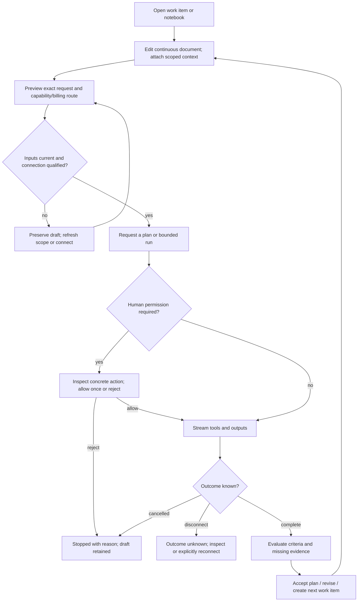
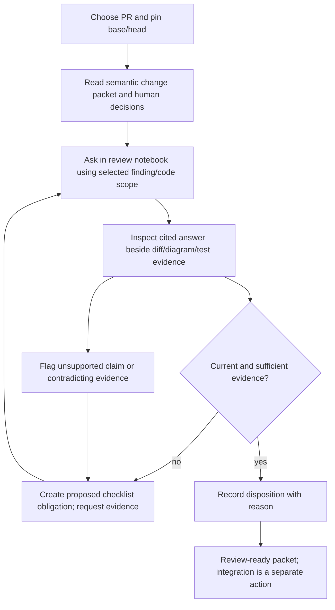
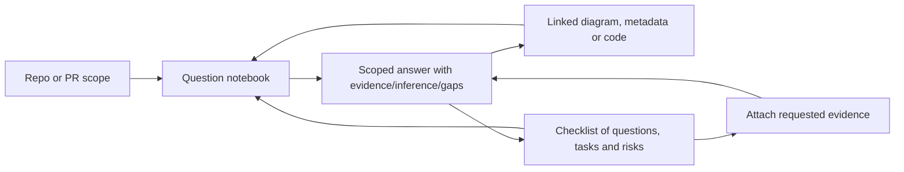

# Part A — Functional intent

This is a **prototype contract**, not accepted product requirements. It reconciles the existing desktop/perspective/editor specifications with the user's October 18 direction. The previous proposal's subordinate execution and horizontally tabbed feature navigation are superseded for this exploration. The underlying WPF desktop and dockable workspace remain.

The expert developer needs to formulate intent precisely, see what an agent did, evaluate the evidence, and decide the next action without switching mental models. The same interaction must answer a repository question, direct implementation, or review a PR. A local notebook contains the human's editable intent; a separate run record contains what was actually submitted and observed.

## Domain model before surfaces

| Context / aggregate | Invariant | Entity / values |
|---|---|---|
| Authoring / Notebook | A saved revision never changes; edits produce another revision | Notebook and revision identities; prose/code/context ranges are values |
| Execution / Run | One attempt pins one submitted revision, scope and provider route; later edits cannot rewrite it | Run, turn, attempt and immutable input snapshot |
| Assurance / Assessment | Evidence and decisions name the exact input baseline | Finding, checklist obligation and evidence references |
| Workbench / Layout | Moving or hiding a pane cannot change or cancel its underlying work | Layout identity; pane placements and linked/pinned scope values |
| Connection / Harness binding | Account, entitlement and capabilities are independently established | Binding identity; provider/product/transport/auth/billing/version values |
| Coordination / projection | Pack authority is preserved; a projection cannot mint a leader, human consent or completion | References to leader epoch, compiled contract, request, ruling, attempt and join record |

Draft history, editor undo, submitted runs and repository checkpoints are different histories. A checklist acknowledgment is not a passed test. A provider response ending is not work acceptance. Generated explanations and summaries do not establish executed evidence.

Non-goals: a hosted product, real provider requests from HTML, API-key-first setup, semantic acceptance from a confidence score, a second coordination authority, a general-purpose notebook kernel, or replacement of the native docking implementation in this design turn.

# Part B — UX specification

## One feature map on the left

Two equally legitimate entry paths precede the three loops. **Start with work** accepts an intent,
task or change and opens Factory or Review with a linked notebook. **Start with the system** opens
repository or PR understanding with a question notebook and visualizer. The latter creates no work
item automatically; questions, findings and checklists can belong directly to a repo/PR investigation.
“Promote to work” is an explicit later decision that retains the originating evidence. The workbench
remembers the last entry context and never forces an exploration through a task-creation wizard.

Factory (development loop): **Prompt notebook, Work items, Execution, Coordination**.
Review: **Pull requests, Review notebook, Test evidence, Rigor backlog**.
Understand: **Ask the repo, Ask a PR, Visualizer, Checklists**.

The three section names stay visible. The selected section expands its children. Feature selection never appears as a horizontal tab strip on the right. Within a visualizer, a view selector chooses Sequence / Components / Data / Code / Metadata; these are representations of the same selection, not another application navigation system.

Shared workspace scope identifies repository or PR, branch/base/head, selected item and freshness. Switching loops preserves drafts and runs. A pinned pane retains its own baseline visibly; an unpinned pane follows the shared selection. Opening an answer's evidence or checklist item carries its provenance rather than opening an unrelated chat.

## Primary structure and docking

The default is a continuous notebook beside execution. The editor is the pane's main surface, not a rounded form field inside a card. Paragraphs, headings, inline references and code live in the same document. Secondary operations appear in a compact toolbar or near the selection.

The run pane contains provider-reported approach summaries, tool events, permissions, output, evaluations and limitations. Reading earlier output disables follow-latest; new output announces its arrival without stealing the viewport. The visualizer and checklist are optional additional docks. Presets: paired, execution below, focus editor, analysis. Each pane also has explicit move/float/restore commands; keyboard alternatives accompany drag and resize. Closing a pane hides it; stopping work is a separate action. Layouts are retained per loop and restored without recreating the run or losing draft state.

## Development loop

Run selected text, active section or document through explicit controls. Rich/source switching preserves the canonical text; unsupported rich content must be disclosed rather than dropped. Save, compare and branch preserve old snapshots. Queue is a later turn; steer is an amendment to a running turn when supported. Stop is a request until terminal acknowledgment; background work and queued successors remain separately visible. No automatic rerun follows a crash or lost connection.

## Review loop

Human review focuses on authority, destructive persistence, security/privacy boundaries, architecture precedents and contradictory or missing evidence. A reviewer can ask “did they think of X?”; the answer may establish inspected implementation/evidence, never the author's unrecorded intent. Wrong-answer controls retain the original answer and create a concern with provenance. A changed PR head makes the packet stale and disables decision recording until re-analysis.

## Understand loop

Questions, visualizations and checklists are three coordinated representations of one investigation. Select a diagram node or code range to ask about it. Promote an unresolved answer into a proposed checklist item; acknowledge it separately from attaching proof. An empty or disconnected index offers a bounded import/retry path and keeps the question draft. A partial answer displays inspected and omitted scope.

## Connections and coordination

Connection path: select one of the six requested products → discover installed harness/version → check the existing native session → **explicitly open that harness's native sign-in only if absent or expired** → establish the effective billing route and advertised capabilities → explicitly qualify a small read-only turn → enable applicable actions. AI-DE does not broker OAuth, transparently negotiate subscription authentication or copy credentials into a generic model client. Reuse the benchmark's isolated native profiles, environment sanitation and native-home concurrency controls; do not inherit its unattended approval policies. The HTML simulates this path and never signs in. A documented protocol is not a qualified runtime. No silent API billing or model substitution occurs.

Coordination supports native child agents, cross-harness spawned agents and independently registered sessions. It shows a common task graph with relationship and harness badges, not a logo-based authority model. Human consent, Owner-model rulings and Coordinator dispatch remain distinct. Presence and progress are separate; a fresh heartbeat can coexist with stalled work. Inspect the five-part contract, exact requests and acknowledgments, seams, evidence and join stages. A registered session gets a stop request; only an owned process gets a direct stop action. Evidence-ready does not mean accepted or merged.

## Falsifiable prototype criteria

| ID | Given / when | Then / failure oracle |
|---|---|---|
| UX1 | Select each primary section | Its feature children appear on the left; no feature tab strip appears across the right pane |
| UX2 | Type, switch loops, revisit | Draft text remains; prior run snapshot remains unchanged and is labeled stale after edits |
| UX3 | Select text and run selection | Exact request preview contains the selection and pinned scope; run is labeled fixture |
| UX4 | Switch rich/source, save, branch, compare | Content survives; snapshots are immutable; history navigation preserves scratch edits |
| UX5 | Move/resize/float/close/reopen execution | Content and run identity persist; hiding does not cancel; keyboard alternatives work |
| UX6 | Start, authorize once, stop, queue and retry | Distinct state changes are visible; no approval or retry is inferred from timeout |
| UX7 | Ask about repo, PR or visualizer selection | Scope appears on question and answer; evidence opens beside it; unknowns stay explicit |
| UX8 | Promote concern and acknowledge checklist | Item retains source; acknowledgment does not claim test success |
| UX9 | Set stale, failed, partial, auth, quota or wrong-answer fixture | Draft remains; relevant recovery exists; unsupported actions are blocked with reasons |
| UX10 | Inspect coordination patterns | Spawned versus registered and presence versus progress remain distinct |
| UX11 | Open optional terminal | Repo path and consent boundary are visible; prompt notebook remains primary; fixture executes no command |
| UX12 | Keyboard-only navigation and 960px viewport | Focus stays visible, dialogs restore focus, panes fit or stack without page-level horizontal overflow |
| UX13 | Type @, / or Ctrl+Space in the editor | Keyboard-operable suggestions show files, symbols, requirements and skills with source/help; accept and dismiss preserve caret and document |
| UX14 | Inspect an inline symbol or diagnostic | Documentation/signature, baseline and suggested correction appear in context; correction is an explicit edit with undo |
| UX15 | Preview a repeated-text edit | Match count, before/after and scope are visible; Apply is explicit and Undo restores the document |
| UX16 | Choose subscription sign-in | Provider-native flow is explicit; app does not request an API key or silently switch authentication/billing route |
| UX17 | Choose Start with work or Start with the system | Both reach a complete loop; system exploration creates no work item until explicit promotion |

Autocomplete and IntelliSense are core capabilities, not optional polish. Production completion sources include indexed files/symbols, requirements, prompt variables and approved skills. Suggestions carry authority and freshness; unindexed or ambiguous matches are labeled. Inline documentation, signature help, diagnostics and previewed corrections keep the author in the document. Multi-selection, search/replace, undo/redo, folding, source navigation and constrained context insertion are the editor floor. Model suggestions are opt-in and distinct from deterministic index-backed completions. The HTML uses disclosed fixtures; production semantic services remain to be qualified.

# Part C — UI direction

Archetype: existing **PerspectiveShell / MultiPanelWorkstation** enclosing a **G3 ComputationalNotebook**. G3 deviations: local-device persistence rather than cloud; explicit user-run rather than reactive external side effects; run outputs can dock beside their source rather than forcing a single vertical feed. Reading evidence is parallel; composing/authorizing one request is serial. Production medium: Windows WPF + WebView2 + AvalonDock, UI Automation plus DOM accessibility; current distribution remains existing desktop packaging, future release trust unqualified.

Audience arrives with several unfinished threads and needs continuity. Adjectives: **immersive / not fragmented; deliberate / not obstructive; inspectable / not theatrical**. References: Claude desktop pane composition, OpenAI scoped annotations and source/preview, Copilot notebook context, Grok history/plan comments, Cursor queue versus steer. Vendor facts and source links live in the proposal's research note; behavior here is proposed AI-DE design.

Type: existing Segoe UI for readable prose and chrome, Cascadia Mono for code and exact identity. Color: existing dark/light semantic tokens; one accent for focus and action. Space: a readable continuous document, generous paragraph rhythm and compact peripheral chrome; separators between panes, no nested card grid. Existing 12/13/15/18/22px ramp, 24px minimum controls, explicit focus ring. No generated imagery.

UI-T1 applies (expert notebook, provenance and quantitative run evidence); UI-T3 applies (model failures/uncertainty, HAX control/correction and Shape-of-AI Governors/Trust builders); UI-T4 applies (native target, HTML is only direction proof); UI-T2 does not apply. Unknown spend is “Not recorded”; no invented usage or confidence score. No continuous data colormap is needed for this specimen. High-contrast HTML uses explicit demonstration tokens; native OS behavior remains unqualified.

Hard states: ready, first-run/empty, loading, error, partial, stale, wrong answer, quota, signed out, unsupported capability, stopped and overflow. Each keeps navigation and drafts usable. The review harness exposes persona, viewport, state, theme, density, reduced motion and capability; it first asserts a non-zero page box, then checks computed contrast, targets and overflow. Native UIA, mixed-DPI docking, IME, large-document typing, packaging and actual provider semantics require later native proof.
