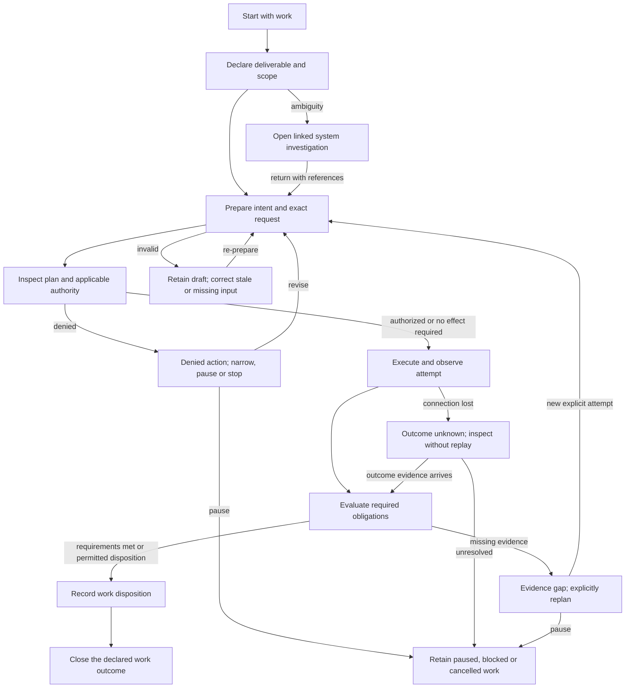
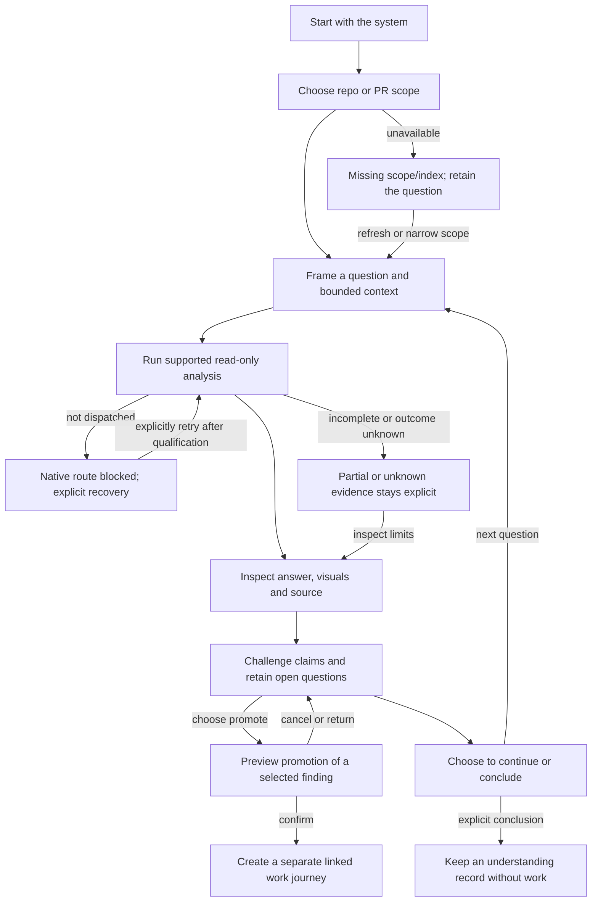

# AI-DE evolution: two journeys, one local workbench

- **Status:** In review. Requirements below specify the target product; they do not claim implementation or human acceptance of this specification.
- **Tier:** T2. Authoring date: 2026-10-18. Accountable owner: @timianmalloo.
- **Basis:** [Notebook workbench proposal](../proposals/local-software-factory-v2.html), captured at `ca04e18b472abc4a4142896c8418191bbb704819`, and the user's explicit instruction to retain both paths as distinct journeys.
- **Artifact continuity:** this document promotes the earlier prototype UX contract in place. Its graph identity and URL stay stable; the prototype-only version remains in the baseline commit.
- **Normative language:** MUST/SHALL identifies required behavior; SHOULD identifies a recommendation requiring a recorded reason if omitted. Acceptance criteria are unexecuted product targets. Verified/Inferred/Flagged labels apply to evidence, not to a claim that a requirement is already built.

**The central distinction:** a work journey pursues a declared deliverable or decision. A system journey pursues understanding. They share capabilities, but have separate purposes, records, authority and completion rules. Neither is merely an alternate landing page for the other.

## Scope reconciliation and authority

This specification refines the following requirements for the proposed evolution. Existing safety,
isolation, provenance and native interaction contracts remain unless explicitly changed below.
Acceptance of the new document is not implied by authoring it.

| Existing contract | Retained | Evolution specified here |
|---|---|---|
| `spec-ai-native-ide` core desktop/workspace and source-viewer scope | Local Windows workbench; repository/worktree isolation; read-only source inspection; uncertainty and provenance | Two durable journeys and a first-class intelligent notebook/execution experience become the primary product workflow |
| `spec-editor-surfaces`, US-ED5–ED8 | Explicit target and dispatch; auditable submission; dirty drafts; real empty/error states | Layout-owned prompt drafts and terminal-first transfer are replaced as the primary authoring path by revisioned notebooks and governed execution requests. The visual editor itself does not become the execution authority |
| `spec-editor-surfaces` source-editor non-goals | No general-purpose repository source editing, refactoring or source-editor-of-record | IntelliSense applies to intent, Markdown/code examples, requirements, skills and context references. Source viewing remains read-only |
| `spec-terminal-sessions` collection and lifecycle | Stable terminal identity/process; explicit creation, target path and termination | Terminal becomes optional. Hide/move pane is distinct from Close terminal session and from Stop agent attempt |
| Addendum C, US-C13 and session-setting rulings | Budget/fan-out are session settings with defaults, not repeated prompt fields; tier is derived by compilation; exact compiled preview; inline validation | Continuous notebook replaces the earlier conversation-only presentation. No second per-prompt budget/fan-out authority is introduced |
| Addendum C mention/scope and layout contracts | Mention-derived scope, explicit authority checks, stable surface identities and layout migration | References produce context and proposed eligible scope; mentioning a file alone does not grant permission to mutate it. Three navigation sections do not silently invalidate saved layout identities |
| Prototype UX contract and mockup | Evidence for the chosen direction and tested fixture interactions | This functional document governs target behavior. Fixture accounts, metrics, graphs and simulated permissions are not product requirements or proof of native availability |

# Part A — Functional specification

## A1. Problem and intended outcomes

Developers need to turn intent into trustworthy work and to understand unfamiliar systems without
losing the evidence behind either activity. Current fragmentation among prompts, terminals, code,
diagrams and review records makes scope, progress and responsibility difficult to retain.

The product SHALL support two primary users' purposes equally:

- **Deliver or decide:** produce a bounded change, plan, investigation deliverable or PR review disposition against declared intent.
- **Understand:** explain a repository, component or PR; inspect relationships; preserve what is known, inferred and unresolved. Understanding is a useful outcome even when no work item is created.

The primary user is an expert developer or technical owner. Supporting roles are a reviewer deciding
on evidence, an investigator entering an unfamiliar repository, and a coordinator supervising bounded
agent work. These are user activities, not assumptions about job titles or administrative permissions.

## A2. Two distinct journey contracts

| Contract | J-W — Start with work | J-S — Start with the system |
|---|---|---|
| Trigger | A desired change, assigned item, explicit deliverable, or request to review a PR for a decision | A repository/PR question, selected symbol, architectural concern or uncertainty |
| Goal | Achieve or make an accountable disposition about the declared outcome | Establish useful understanding and retain its supporting evidence and limits |
| Primary record | Work intent or review assignment, with its accepted baseline and obligations | Investigation with its scope, questions, conclusions and open considerations |
| Core path | Frame outcome → prepare intent/request → plan where needed → authorize applicable execution → inspect results → evaluate obligations → record disposition | Establish scope/question → inspect available evidence → ask → compare source/visuals/tests → challenge interpretation → retain findings → conclude or continue |
| Successful closure | The declared deliverable is accepted or an explicitly requested review/decision deliverable is recorded. An implementation goal with missing mandatory evidence is not accepted merely because the agent stopped | User concludes with an answered question, bounded partial explanation or explicitly unresolved finding. No work item, implementation plan or work-acceptance gate is required |
| Other outcomes | Paused, blocked, denied, cancelled, or execution outcome unknown; none means accepted work | Paused, cancelled, evidence unavailable or question unanswered; retained material remains available |
| Authority | May include changes/checks only within the concrete authorized scope. A review assignment may remain entirely read-only | Defaults to observation/explanation. Editing local investigation notes does not authorize mutation of inspected repository artifacts |
| Relationship to the other journey | May open a linked investigation without abandoning work or rewriting accepted intent | May explicitly promote selected findings into proposed work while preserving the investigation |

**Same PR, different journeys:** “Explain PR 184” starts J-S. “Review PR 184 and record whether it is
ready for approval” starts J-W with a review deliverable. The PR's object type alone SHALL NOT select
the journey purpose. Factory, Review and Understand are places to work, not journey identities.

## A3. Product scope

**In scope:** local desktop workspace; both journeys; intelligent continuous prompt/notebook
authoring; peer execution/evaluation; scoped repo/PR questions; source and graphical understanding;
checklists, test worthiness, drift and rigor review; explicit native subscription-harness use;
multi-agent coordination; durable history; dockable surfaces; optional hosted repo terminal.

**Explicit non-goals:** a hosted replacement product; a general-purpose source IDE or arbitrary
notebook kernel; transparent OAuth/credential brokering; API-key-first setup or hidden billing
fallback; automatic work creation from every question; model confidence as acceptance; automatic
merge/push/release; mandatory voice/audio input. “Multimodal” in this scope means authored questions,
diagrams/source/metadata and structured checklists/evidence. Additional media ingestion requires a
separately qualified capability and is not necessary to complete either journey.

## A4. Conceptual domain model

The model is specified before UX. These are domain concepts and invariants, not storage tables,
wire schemas or library choices. Entities retain identity; value objects describe one immutable
meaning; aggregates are small and refer to other aggregates by identity.

| Bounded context / aggregate root | Entities and value objects | One protected invariant |
|---|---|---|
| Work / Work intent | Work intent entity; accepted intent revision, deliverable definition, outcome and obligation references | Work acceptance always names the declared deliverable, exact intent baseline and required evidence/dispositions |
| Understanding / Investigation | Investigation and question entities; scope snapshot, conclusion and uncertainty descriptions | An investigation can exist, resume and conclude without any work item |
| Authoring / Notebook | Notebook and saved revision entities; text/code structure, context references and selected ranges | Saved/submitted revisions are immutable; view changes and edits cannot rewrite them |
| Execution / Execution attempt | Attempt entity; prepared input, route/profile, permission references and observed outcomes | One attempt retains its exact submitted input, scope and actual route throughout its life |
| Assurance / Assessment | Assessment, claim/finding and disposition entities; evidence references and baseline | A current assessment never combines incompatible baselines or promotes absent/inferred evidence into observed proof |
| Assurance / Checklist | Checklist and obligation entities; acknowledgment and evidence state | Human acknowledgment and demonstrated satisfaction are distinct facts |
| Authority / Permission decision | Decision entity; requesting action, actor, scope, offered option and expiry | One decision authorizes only its concrete supported action and cannot grant a different request |
| Connections / Native harness binding | Binding entity; external account/profile reference and capability observations | Readiness is qualified for a particular native profile and capability; credentials remain native-harness-owned |
| Workbench / Saved layout | Layout entity; pane placements, focus target and pinned/linked selection values | Rearranging or hiding a view cannot change the lifetime or identity of its content |

Coordination is an authoritative external domain projected into this workbench. Leader designation,
contract, request, acknowledgment, ruling, seam and join records remain references to their owning
authority; the UI does not create a competing leader or permission truth.

### Ubiquitous language and separations

- **Journey purpose:** work accountability or system understanding. It survives navigation and restart.
- **Scope snapshot:** the inspected repository/worktree, relevant content state, accepted intent revision and, for PRs, exact base/head. Dirty content under unchanged HEAD must be distinguishable.
- **Session:** a native conversation/execution context with its own settings and lifecycle; it is not the journey or a pane.
- **Execution attempt:** one dispatch of a prepared request. The user-facing execution surface may call this a run. Retrying creates a new linked attempt. A queued follow-up becomes its own attempt when dispatched; provider turn identifiers remain provenance rather than replacing product identity.
- **Evidence:** an identified observation/artifact with its producer, scope, baseline, time, limitations and verification status. A source link alone is not executed proof.
- **Finding:** an observed or inferred concern with its evidence and uncertainty. It is not automatically accepted work.
- **Acceptance:** an authorized disposition of the declared outcome at an exact baseline; distinct from plan agreement, permission, transport completion and integration.
- **Ownership rule:** a checklist or notebook has an owning work or investigation context; it need not have both. Cross-journey use references origin or creates an explicitly linked derivative. No mandatory Work Item reference is imposed on all notebooks, runs or checklists.

## A5. Functional user stories and acceptance criteria

Each criterion below is a future test oracle, not a declaration that the mockup or current product
already passes it. A positive and a refusal/error case are required for each story.

### US-J01 — Choose and retain a journey purpose

As a user, I want my purpose to survive changes of surface so that the workbench does not redefine what I am doing.

- **AC-J01a:** **Given** a repository or PR, **When** I choose Start with work or Start with the system, **Then** the resulting context records the chosen purpose and exposes its distinct goal and closure action.
- **AC-J01b:** **Given** an investigation, **When** I visit Factory, Review and Understand or reopen the workspace, **Then** its purpose, questions, scope and drafts remain an investigation and no work item is created.
- **AC-J01c:** **Given** an active work context, **When** I switch panes, scope selection or journey view, **Then** the original work and submitted attempts remain available and no provider dispatch, queue item or acceptance is created by navigation.

### US-W01 — Frame the work outcome

As a work owner, I want a clear deliverable and obligations so that execution has an accountable stopping condition.

- **AC-W01a:** **Given** an intent or review assignment, **When** I prepare it, **Then** goal, completion conditions, exclusions and selected scope are derived/prefilled where possible, editable inline and visible before submission; the deliverable may be a plan, change, bounded investigation or review disposition.
- **AC-W01b:** **Given** a required content field is missing or contradictory, **When** I attempt to submit, **Then** preparation is blocked at the relevant text with a specific correction and the draft is retained; mandatory repeated boxes are not introduced.
- **AC-W01c:** **Given** session budget/fan-out defaults and a derived tier, **When** the request is prepared, **Then** its effective limits and scope are disclosed in the exact preview without introducing a second per-prompt budget/fan-out authority or treating a mention as execution permission.

### US-W02 — Plan and execute bounded work

As a work owner, I want to inspect the effective request and applicable authority before an agent acts.

- **AC-W02a:** **Given** valid intent and a qualified route, **When** I explicitly submit, **Then** the workbench binds the accepted/prepared intent, scope, selected route and applicable limits to an attempt; planning and additional approval occur where the work's policy requires them.
- **AC-W02b:** **Given** a concrete action requires a human decision, **When** the native request arrives, **Then** it identifies the action, scope, expected effects and supported options; rejecting or expiring that request prevents that action and preserves its reason.
- **AC-W02c:** **Given** the plan or a model-seat ruling is accepted, **When** another side effect requires authority, **Then** the prior plan/ruling cannot substitute for the required concrete permission.

### US-W03 — Evaluate and close the declared work

As a work owner, I want completion to reflect evidence against my declared deliverable.

- **AC-W03a:** **Given** an attempt has ended, **When** I evaluate work, **Then** each mandatory obligation shows its evidence or explicit gap and the work outcome remains separate from the attempt outcome.
- **AC-W03b:** **Given** a mandatory obligation lacks evidence, **When** an agent says “done,” **Then** work remains unaccepted unless an authorized disposition explicitly permitted by policy addresses that obligation; the gap never becomes falsely satisfied.
- **AC-W03c:** **Given** the declared deliverable is a review disposition or plan rather than implementation, **When** I accept that exact deliverable, **Then** the journey may close with that named outcome without claiming the underlying PR is merged or implementation is complete.

### US-S01 — Investigate without creating work

As an investigator, I want to ask about the system before deciding whether any change is needed.

- **AC-S01a:** **Given** a repo, component, PR or selected object, **When** I start a system journey, **Then** I can create and run a scoped question notebook, inspect output and retain findings without creating a work item, implementation plan or work-acceptance gate.
- **AC-S01b:** **Given** there is no usable index, access is unavailable or the language is unsupported, **When** I ask, **Then** the question is retained, the unavailable scope is named and refresh/import/narrow-scope or bounded absence-of-evidence paths are offered only where supported.
- **AC-S01c:** **Given** read-only investigation authority, **When** I edit local investigation notes, acknowledge a finding or encounter a model instruction to change code, **Then** no authority to mutate inspected repository artifacts is gained. An explicit export to a chosen path is a separate user action.

### US-S02 — Inspect, question and challenge understanding

As an investigator, I want questions, diagrams, source and metadata to remain connected to the same evidence.

- **AC-S02a:** **Given** a scoped answer, **When** I select its cited symbol, code range, relationship or result, **Then** the visualizer opens that object and an Ask action carries its identity and baseline into the next question.
- **AC-S02b:** **Given** an inferred relationship, omitted scope or unknown reference, **When** it is displayed or questioned, **Then** the system retains the uncertainty and does not substitute a known symbol, invent a runtime relationship or claim whole-repository coverage.
- **AC-S02c:** **Given** an answer is contradicted or unsupported, **When** I challenge it, **Then** the original answer/baseline is retained and the counter-evidence or open question can become a proposed checklist obligation.

### US-S03 — Conclude understanding on its own terms

As an investigator, I want a useful understanding record to be a valid outcome in its own right.

- **AC-S03a:** **Given** an explanation and retained evidence, **When** I explicitly conclude the investigation, **Then** I can record answered, bounded-partial or unresolved-with-reason as the conclusion and no work item or implementation obligation is required.
- **AC-S03b:** **Given** open questions remain, **When** I save or conclude with uncertainty, **Then** those questions remain visible and are not marked resolved, satisfied or accepted work merely because the investigation is closed.
- **AC-S03c:** **Given** a concluded or paused investigation, **When** I reopen it, **Then** its questions, original baseline and conclusions remain inspectable; new input creates a new/current investigation revision without rewriting earlier meaning.

### US-B01 — Promote selected understanding into work

As an investigator, I want to turn a chosen finding into accountable work without losing its origin.

- **AC-B01a:** **Given** a question or finding, **When** I choose Promote to work, **Then** the proposed goal, scope, obligations and origin links are previewed and creation requires an explicit confirmation.
- **AC-B01b:** **Given** the preview is cancelled, **When** I return, **Then** no work record is created and the original investigation, draft and uncertainty are unchanged.
- **AC-B01c:** **Given** promotion is confirmed, **When** the new work opens, **Then** the investigation remains separately available, provenance and uncertainty are retained, and neither implementation permission nor acceptance is inherited from the finding or acknowledgment.

### US-B02 — Open an investigation from work and return

As a work owner, I want to explore uncertainty without losing accountable intent or pending execution.

- **AC-B02a:** **Given** work with a draft and active/waiting attempt, **When** I open a linked investigation and return, **Then** the work baseline, draft, obligations and attempt identity/state remain available.
- **AC-B02b:** **Given** new exploratory evidence, **When** I return to work, **Then** evidence can be attached deliberately but accepted intent is not silently rewritten; changing intent creates a new revision and invalidates dependent preparation/currentness as appropriate.
- **AC-B02c:** **Given** the same PR is open in either journey, **When** I explicitly request an accountable review disposition, **Then** a linked review assignment with its own outcome and exact base/head is created; merely opening the PR does not create that assignment.

### US-E01 — Author an immersive document in either journey

As an author or investigator, I want the same capable editor in both journeys.

- **AC-E01a:** **Given** either journey, **When** I compose prose, headings, lists, code examples and references, **Then** they form one continuous keyboard-editable document with rich and source projections, structural navigation, search and folding; system questions do not receive a reduced text-box editor.
- **AC-E01b:** **Given** a supported document with language-tagged code, whitespace and references, **When** I switch projections, navigate away or save/reopen, **Then** its supported content and identities are preserved without an unrequested edit.
- **AC-E01c:** **Given** an unsupported document structure or paste, **When** a conversion would lose meaning, **Then** the limitation is disclosed before destructive conversion and a lossless source/retained-original path remains available.

### US-E02 — Complete and inspect context with IntelliSense

As a keyboard-oriented user, I want accurate in-context assistance that exceeds terminal text entry.

- **AC-E02a:** **Given** indexed files, symbols, requirements, skills and prompt variables, **When** I type a trigger or request completion in either editor projection, **Then** suggestions can be filtered, inspected, selected and dismissed by keyboard while preserving the caret and document.
- **AC-E02b:** **Given** duplicate names, an unindexed symbol or stale context, **When** help or signature information is requested, **Then** the actual identity, ambiguity/freshness and source are shown; no arbitrary first match is presented as resolved metadata.
- **AC-E02c:** **Given** deterministic context help and optional model-generated suggestions, **When** they appear, **Then** their origin is distinguishable; model rewrites require preview/acceptance, and dismissing an empty or closed popup leaves no nonexistent active accessibility option.

### US-E03 — Revise, compare, branch and perform precise edits

As an author, I want editor-grade changes and durable prompt history without confusing them with execution history.

- **AC-E03a:** **Given** a draft and saved revisions, **When** I navigate the prompt stack, compare or branch, **Then** scratch edits are retained and saved/submitted revisions remain immutable and returnable.
- **AC-E03b:** **Given** a multi-selection or repeated-text edit, **When** I preview/apply it, **Then** affected ranges, match count and before/after are visible, and one undo restores the exact prior document; a changed document invalidates a stale edit preview.
- **AC-E03c:** **Given** editor undo or a repository checkpoint operation, **When** it is used, **Then** its exact scope is stated and it does not claim to stop an attempt, undo external effects or rewrite submitted evidence.

### US-E04 — Prepare an exact, bounded request

As a user, I want to know the input and destination before a model receives it.

- **AC-E04a:** **Given** a document, section or selected range, **When** I prepare it, **Then** the exact serialized text, resolved references, selected scope/baseline, actual native route and applicable limits are inspectable before explicit submission.
- **AC-E04b:** **Given** a prepared request, **When** text, referenced content, dirty working-tree content under unchanged HEAD, profile or relevant policy changes, **Then** preparation becomes stale and dispatch requires re-preparation; no old preview is silently sent as the new request.
- **AC-E04c:** **Given** a missing/ambiguous reference, unavailable route or exceeded context bound, **When** preparation occurs, **Then** it names the issue and required correction or explicit bounded omission; it does not silently substitute context, drop content or claim a complete request.

### US-R01 — Retain the identity of every execution attempt

As a user, I want observed activity to remain tied to the input and route that produced it.

- **AC-R01a:** **Given** a submitted revision A, **When** I edit to B, select another account/provider or change layout/journey, **Then** A's attempt retains its submitted input, scope, actual route and event history; its result is identified as belonging to A.
- **AC-R01b:** **Given** an uncertain delivery or lost connection, **When** I reconnect or inspect status, **Then** outcome remains unknown until evidence establishes otherwise, and no resend or retry is triggered by inspection/navigation.
- **AC-R01c:** **Given** I explicitly retry after inspecting uncertainty and surviving work, **When** the new request is dispatched, **Then** it has a new attempt identity linked to the original; the original attempt and its possible effects are not overwritten.

### US-R02 — Inspect execution and evaluation as a first-class surface

As a user, I want activity, output and limitations beside the editable document.

- **AC-R02a:** **Given** an active attempt, **When** events arrive, **Then** the execution surface shows approach summaries when supplied, concrete tools, permissions/input requests, outputs and evaluation references with their source and omissions; native diagnostic output remains inspectable subject to the credential-protection requirement in AC-A01c, with redaction disclosed rather than a secret-bearing exception.
- **AC-R02b:** **Given** no readable reasoning summary, missing usage or a denied tool, **When** the response ends, **Then** absence/denial remains explicit; hidden reasoning, cost, success or accepted work is not invented from process exit or model language.
- **AC-R02c:** **Given** I am reading earlier output, **When** new output arrives, **Then** it does not steal scroll/focus; I can resume follow-latest, inspect retained attempts and identify which result belongs to which revision.

### US-R03 — Control queued, active and interrupted work precisely

As a user, I want different controls for different execution effects.

- **AC-R03a:** **Given** an active request, **When** I queue a follow-up or explicitly steer where supported, **Then** queued work is a later request and steering is a recorded amendment; neither silently rewrites the original input.
- **AC-R03b:** **Given** I request Stop, **When** the request is sent, **Then** status is stop-requested until acknowledged, queued successors/background work are separately accounted for, and interruption does not claim rollback.
- **AC-R03c:** **Given** an unsupported control, busy native profile or expired limit, **When** I request an action, **Then** the limitation and supported recovery are shown; no synthetic permission/cancel/resume event is presented as a native acknowledgment.

### US-H01 — Select and use an explicitly authenticated native harness

As a user, I want to use my existing subscriptions through their native harnesses.

- **AC-H01a:** **Given** the connection selector, **When** I inspect it, **Then** Anthropic/Claude, OpenAI/Codex, Microsoft/GitHub Copilot, Meta/Muse Code, Grok/Grok Build and Google/Antigravity appear as distinct product targets with actual availability/qualification states, not six implied built integrations.
- **AC-H01b:** **Given** a selected installed harness, **When** I check its existing native session, **Then** a usable cached sign-in can be reused without mandatory re-login; when absent/expired, the user explicitly opens that harness's native sign-in and rechecks the selected profile.
- **AC-H01c:** **Given** native sign-in/profile configuration, **When** the workbench launches or reports the route, **Then** credentials stay native-owned; no app-owned OAuth negotiation, API-key-first form, copied credential in a generic model client or inherited API-key override silently changes the selected subscription route.

### US-H02 — Qualify capabilities and recover without hidden fallback

As a user, I want readiness to mean what the selected native profile has actually established.

- **AC-H02a:** **Given** profile observations, **When** readiness is displayed, **Then** installation, native authentication/billing route, required model access and required capabilities are separately evidenced; a missing mandatory observation prevents that readiness claim. Optional quota/usage observations may remain Not recorded without inventing zero or unlimited capacity.
- **AC-H02b:** **Given** authentication, model, quota, capability or profile-concurrency failure, **When** I recover, **Then** my pending request is retained and each failure has its own remedy; changing account/provider/model/billing route or permission posture requires an explicit user choice or an already-approved visible routing policy.
- **AC-H02c:** **Given** a route without qualified interactive permission handling, **When** a write-capable step needs a decision, **Then** no unsupported approval control is offered; the step remains undispatched and the user can inspect native policy or choose supported read-only work.

All six families are target scope. Before a family is advertised as ready, its selected version/profile
must demonstrate a native authenticated, scoped read-only request and the relevant negative cases.
Release staging may expose an unqualified family honestly; it cannot be counted as completed
integration merely because a selector row exists. Native quota, policy or event differences remain
visible rather than being erased by a nominal common protocol.

### US-P01 — Understand a PR through behavior and questions

As an investigator or reviewer, I want semantic change context and evidence rather than an obligation to sift through every diff first.

- **AC-P01a:** **Given** an exact PR base/head, **When** I open a change packet, **Then** it groups changes by behavior/boundary, shows before/after implications, affected intent, production/tests and inspected/omitted scope, while keeping the full diff/source reachable.
- **AC-P01b:** **Given** that packet in either journey, **When** I ask “how is Y implemented?” or “did they think of X?”, **Then** the answer cites inspected evidence and separates inference/absence; it does not claim the author's unrecorded intent.
- **AC-P01c:** **Given** a retained answer/disposition for head A, **When** relevant head B arrives, **Then** A remains inspectable as historical evidence and is not represented as a current assessment of B.

### US-P02 — Make productive human review decisions

As a reviewer, I want the tool to identify the decisions requiring judgment and retain my reasoning.

- **AC-P02a:** **Given** authority/credential, destructive persistence, privacy, release, new domain invariant/architecture precedent, contradictory intent or incomplete-analysis concerns, **When** review readiness is assessed, **Then** the required human judgment and reason are visible; no confidence, diff-size or coverage threshold alone removes it.
- **AC-P02b:** **Given** current evidence and a named concern, **When** I record fixed, false-positive, intentional, deferred or needs-decision, **Then** the actor, reason, exact baseline and any owner/follow-up are retained separately from a remote PR approval, merge, push or release.
- **AC-P02c:** **Given** stale evidence or an unresolved mandatory judgment, **When** acceptance is requested, **Then** the affected acceptance remains blocked until currentness is revalidated and the judgment is resolved, or a human disposition explicitly permitted by policy addresses the obligation at the current baseline. Saving an outstanding review state is allowed but is not acceptance and does not satisfy the obligation; missing or stale evidence is never relabeled as current proof.

### US-T01 — Assess tests for coverage and worthiness

As a reviewer, I want to know whether the tests address the relevant behavior and what their execution actually established.

- **AC-T01a:** **Given** a PR, component or repository scope, **When** test analysis runs, **Then** considerations are mapped to actual assertions/oracles and execution evidence, with uncovered considerations, redundant candidates and efficiency concerns identified with reasons.
- **AC-T01b:** **Given** pass/failure/retry history, **When** rates or suspected flakiness are shown, **Then** numerator, denominator, attempt/environment and window are retained; retry success does not erase failure, and suspected flakiness is distinct from established nondeterminism.
- **AC-T01c:** **Given** no measurement or no demonstrated assertion, **When** the result is summarized, **Then** it says Not recorded or missing consideration rather than zero coverage or proven coverage; links and percentages alone cannot satisfy an obligation, and proposed redundancy does not automatically delete tests.

### US-T02 — Compare implementation with intent and architecture

As an owner or investigator, I want drift analysis to identify meaningful differences without rewriting history to fit the code.

- **AC-T02a:** **Given** versioned requirements, architecture/accepted design references, implementation and test evidence, **When** comparison runs, **Then** it names aligned, changed, missing, contradicted and unassessed considerations with precise source/baseline references.
- **AC-T02b:** **Given** a mockup, PoC or exploratory proposal is used as input, **When** drift is reported, **Then** its authority/status is explicit; an exploratory artifact is not silently treated as an accepted production requirement.
- **AC-T02c:** **Given** uncertain or incomplete extraction, **When** a finding is produced, **Then** scope, omissions and inference remain visible; no spec, architecture or accepted baseline is automatically rewritten to erase the discrepancy.

### US-G01 — Keep a reviewable rigor backlog

As an owner, I want resilience, compliance, privacy, performance and security risks to become deliberate decisions.

- **AC-G01a:** **Given** a risk finding, **When** it enters the backlog, **Then** category, scope/baseline, evidence, impact, uncertainty and proposed owner/disposition are available.
- **AC-G01b:** **Given** a finding is dismissed, deferred or promoted, **When** that action occurs, **Then** its reason and links are retained; a proposed concern does not automatically become accepted work or an executed mitigation.
- **AC-G01c:** **Given** contradictory evidence or a changed baseline, **When** the backlog is reopened, **Then** the contradiction/staleness remains visible and the affected decision can be revisited without erasing history.

### US-U01 — Summarize what happened with grounding

As a user returning to a turn, change or investigation, I want a concise result that leads to its proof.

- **AC-U01a:** **Given** an ended attempt or reviewed change, **When** a summary is produced, **Then** it states intended versus observed outcome, changed behavior/artifacts, production and test references, relevant diagram views, failed/omitted checks and remaining work or uncertainty.
- **AC-U01b:** **Given** no output or no evidence, **When** the summary is produced, **Then** it states that absence rather than inventing accomplishment; model-authored explanation is identified separately from observed execution.
- **AC-U01c:** **Given** a summary claim, **When** I follow its evidence, **Then** the exact baseline and source/test/attempt context are reachable; a stale summary remains historical rather than silently refreshing its meaning.

### US-C01 — Understand actual coordination relationships

As a coordinator or observer, I want a truthful picture of who owns what and what is progressing.

- **AC-C01a:** **Given** a native sub-agent fleet, cross-harness spawned workers or independently registered sessions, **When** coordination is displayed, **Then** actual relationship, designated leader/epoch, contract, artifact expectations, limits, seams and decisions are visible without inferring parentage from timestamps or vendor logos.
- **AC-C01b:** **Given** a fresh heartbeat with no meaningful progress, **When** status is displayed, **Then** presence and stalled progress can coexist and neither proves task completion. Absent observations remain Not checked/Not recorded.
- **AC-C01c:** **Given** a request acknowledgment for an older artifact or stale leadership evidence, **When** an affected operation is requested, **Then** the relevant stale authority/currentness condition is disclosed and blocks that operation until resolved; the UI cannot mint a replacement ruling or leader.

### US-C02 — Govern dispatch, recovery and joining

As a coordinator, I want concrete controls over bounded work without losing authority or recovery evidence.

- **AC-C02a:** **Given** a prepared delegation, **When** dispatch is requested, **Then** objective, artifacts, allowed tools, boundaries/usage/fan-out/context limits, deadline and termination/fallback are inspectable and required qualification/authority checks precede execution.
- **AC-C02b:** **Given** an owned spawned child versus an independently registered peer, **When** Stop is requested, **Then** the supported owned-process control and a peer stop request are distinguished; timeout, notification or a model ruling cannot be reported as human consent or acknowledged termination.
- **AC-C02c:** **Given** an interrupted attempt or join, **When** recovery is opened, **Then** completed steps and original evidence remain inspectable, no possibly effective action is silently replayed, and transport-complete, evidence-present, review-ready, accepted and integrated remain separate states.

### US-D01 — Arrange content without changing its meaning or lifetime

As a user, I want a dockable workspace suited to my current task.

- **AC-D01a:** **Given** either journey, **When** I move, resize, float, pin, hide or reopen notebook/execution/visualizer/checklist panes, **Then** their content identity, relevant caret/selection, baseline, draft and active attempt remain intact, with a keyboard equivalent for every pointer-only arrangement action.
- **AC-D01b:** **Given** a saved layout or missing/off-screen display, **When** it is restored, **Then** existing surface identities are preserved or migrated and unusable placement recovers visibly to a usable arrangement without deleting content.
- **AC-D01c:** **Given** pinned and linked panes, **When** shared selection changes, **Then** each pane's effective scope is visible; a pinned old baseline is not silently relabeled as current and no run is cancelled by a view operation.

### US-D02 — Open a terminal deliberately

As an expert user, I want an optional repo CLI without making it the primary prompt model.

- **AC-D02a:** **Given** an available repository/worktree, **When** I explicitly open a terminal, **Then** its path, identity and process state are visible and the notebook remains available as the primary authoring surface.
- **AC-D02b:** **Given** a live terminal, **When** its pane is hidden or another pane changes, **Then** the process remains alive; explicitly closing its session states the process consequence and is distinct from hiding the pane or stopping an agent attempt.
- **AC-D02c:** **Given** the requested path is missing, inaccessible or outside the allowed workspace, **When** opening is attempted, **Then** no terminal silently opens at a different directory and a concrete recovery is offered.

### US-A01 — Preserve authority and context boundaries

As a user, I want input and agent output to remain evidence rather than unauthorized instructions.

- **AC-A01a:** **Given** repository text, diff, logs or retrieved content that instructs an expanded action, **When** the agent encounters it, **Then** it cannot grant authority or enlarge the accepted scope; conflicts retain their origin for inspection.
- **AC-A01b:** **Given** a proposed action whose scope/profile/arguments changed after permission, **When** execution is attempted, **Then** the old decision cannot authorize the changed action and supported re-authorization or refusal occurs.
- **AC-A01c:** **Given** credentials or a marked sensitive value in native configuration/error fixtures, **When** requests, ordinary logs or proof exports are prepared, **Then** authentication material is not exposed, included context/destination is inspectable and no external publication happens implicitly.

### US-L01 — Retain, recover and deliberately export user knowledge

As a user, I want the workbench to preserve my work and accurately explain retention and deletion.

- **AC-L01a:** **Given** a draft/revision or investigation has been acknowledged as saved, **When** the application restarts or an attempt disconnects, **Then** the saved content, journey purpose and original scope are recoverable; failed storage cannot display a successful save acknowledgment.
- **AC-L01b:** **Given** an unavailable repository or corrupt/unsupported saved view, **When** retained material is opened, **Then** it remains inspectable at its historical baseline with a recovery path rather than becoming an empty current repository or disappearing knowledge.
- **AC-L01c:** **Given** export, clear or retention controls, **When** I inspect/confirm them, **Then** the affected local drafts/history/paths and configured policy are explicit; clearing local data does not claim deletion of provider data or governed repository history. Unknown provider retention remains unknown.

## A6. Non-functional acceptance and measurement

This is the repository's ISO/IEC 25010-derived checklist plus applicable privacy, safety and
observability lenses; it is not a certification claim. Inherited budgets are retained. New targets
are specified requirements, not measurements of today's prototype.

| ID / attribute | Required target and oracle |
|---|---|
| NFR-01 Functional suitability | Both J-W and J-S pass their complete scenarios and negative cases independently. No mandatory work-item reference, work acceptance or implementation plan may be hidden inside J-S completion |
| NFR-02 Performance efficiency | Preserve inherited p95 under 2 s for supported affected-view refresh/initial selected view, under 100 ms for selection/focus and under 250 ms for filtering on the approved corpus. Editor input p95 under 50 ms for a 100k-character supported notebook is the new target from the proposal. Report corpus/version, hardware, warm/cold setup and at least 30 observations per measured case; model latency is measured separately |
| NFR-03 Reliability | After successful save/receipt acknowledgment, a forced restart retains that record and its baseline. Failed refresh preserves last successful evidence with a stale/failed label. Uncertain delivery never causes automatic replay of potentially effective actions |
| NFR-04 Usability / CLI comparison | On the six tasks below, keyboard-only completion must produce no wrong-scope dispatch or corrupted content, require no manual context copying for supported reference/selection operations, and retain all evidence. A paired evaluation against the same native CLI must show no median interaction-time regression and reduced context-transfer steps for the context-bearing tasks; report all results, not a single favorable average |
| NFR-05 Accessibility | Native WCAG 2.2 AA interaction outcomes, UI Automation names/roles/states and WebView/native focus handoff must be verified; every drag operation has a keyboard equivalent. Text/UI contrast, non-color status, reduced motion and focus restoration are tested in supported light/dark/high-contrast and 100/150/200% scale conditions |
| NFR-06 Security | Negative fixtures for wrong workspace/profile, stale permission, untrusted instructions and credential leakage must be refused without performing the forbidden effect. Authority is derived from the concrete approved scope and qualified route, never model text or ambient credentials |
| NFR-07 Privacy / retention | Inspectable context and destination precede sending; typed authentication secrets do not enter prompts/logs/proof. Local and provider retention/deletion scopes are distinguished. Production rollout requires a documented, user-visible local retention default; this spec does not invent a universal provider retention duration |
| NFR-08 Compatibility | Windows desktop and repository/worktree isolation remain required. Saved notebooks/layouts/history from supported existing versions migrate or remain recoverable. Six harness families are qualified separately by exact profile/version; an optional unsupported feature cannot be reported as available |
| NFR-09 Maintainability / testability | Each requirement maps to a named oracle and appropriate evidence layer. No view owns a competing fact/authority. Deterministic context/permission/state checks can be verified without a live model; provider-specific behavior has isolated qualification evidence |
| NFR-10 Portability / recovery | Export/recovery of irreplaceable user knowledge is documented before it is stored. Layout format/version failures recover to a usable arrangement. Cross-platform native clients and cloud workspace sync are outside this evolution's required delivery |
| NFR-11 Observability / resource bounds | Normal execution records attempt/journey/scope correlation, route, latency, output volume, failures and emitted usage. Missing cost/tokens remain Not recorded. Time/output/turn/retry/fan-out bounds and deadline behavior are visible; context ceiling and consumption budget are distinct. Limits disclose partial results and omissions rather than silently truncating success |
| NFR-12 Safety / integrity | A response, heartbeat, exit code, file link or acknowledgment never becomes acceptance by itself. Source, runtime observation, inference, unknown and stale remain distinct through summaries, graphs, promotion and decisions. No automatic reassignment, merge/push/release or destruction follows a model finding |

**CLI comparison tasks:** insert/inspect a symbol reference; revise repeated text safely; compare and
branch prompt versions; ask about a selected diagram/code relationship; understand a failed/unknown
attempt; capture and revisit a test gap. Use matched tasks, the same qualified native route and
controlled outputs, and counterbalanced order for representative keyboard-proficient users. Report
per-task accuracy, interaction time and context-transfer steps. The editor is not accepted as
“superior to CLI” merely because more controls are present. Native validation must include IME,
clipboard, multi-selection, undo and large documents; the HTML fixture is insufficient.

Large-graph scale limits remain a release-qualification dependency inherited from the existing
specification. Until a representative corpus and bound are measured, the product must expose
supported/omitted scope and cannot claim unbounded repository analysis.

## A7. Boundary set and governance

Mandatory boundary fixtures cover: empty workspace/no work/no investigation; dirty content under
unchanged HEAD; changed PR head or criterion; unsupported language/index; absent/ambiguous symbol;
oversized context/graph/frame; corrupt or legacy history/layout; cancelled promotion; readonly
review assignment; stale permission/ACK/leader; signed-out, wrong-account, busy, quota-limited or
unqualified native route; disconnect after possible effect; denied tool with successful process
exit; surviving background work; conflicting findings; invalid export path and sensitive output.

| Lens | Applicability and required control |
|---|---|
| Traceability / quality | Applies: story → acceptance criterion → UX flow/surface → planned oracle → implementation proof. Coverage is not inferred from test-file existence |
| Spoofing | Applies: distinguish the human, Owner model, Coordinator, native account and registered/spawned relationships; wrong-profile/epoch evidence blocks the affected action |
| Tampering | Applies: prepared input and baseline changes invalidate preparation/currentness; prior snapshots and decisions remain immutable |
| Repudiation | Applies: action, actor, selected option, baseline, attempt and outcome/uncertainty remain attributable without secret-bearing logs |
| Information disclosure | Applies: inspectable bounded context, destination and exports; native credential ownership; no inherited API-key route surprise |
| Denial of service | Applies: finite context/output/runtime/retry/fan-out bounds; visible partial/over-limit states; UI remains usable for stop/inspect |
| Elevation of privilege | Applies: model/repository text and other journey findings cannot grant new permission; native capability absence fails closed for that action |
| Privacy / accessibility / performance | Applies through NFR-02/04/05/07/11 and the native proof obligations |
| Release / rollback / migration | Applies: preserve existing knowledge/layout identities; rollout cannot label unqualified native features ready; rollback/export cannot erase or reinterpret accepted history |
| Supply chain | Applies at implementation: qualify native tool versions and dependency licensing; this functional spec chooses no new editor library or package |
| Incident readiness | Applies: operator can identify affected attempt, last known state, outstanding effects and safe recovery when a native process or index fails |
| Imported guide examples | CoachApp/M365-specific storage and UI examples in the inherited governance guide do not apply to AI-DE. Its general governance lenses apply; AI-DE's actual desktop/data contracts govern specifics |

## A8. Evidence and AI allocation

| Claim / decision | Source | Confidence |
|---|---|---|
| Both journeys must remain distinct; desktop/docking, intelligent editor, optional terminal and explicit native auth are required | User's October 18 instructions and current `$specify` request; [direction note](../notes/workbench-loops-direction.html) | Verified user direction |
| The prototype demonstrates local interactions, not production integration | [36-check proof and scoped reviews](../proof/workbench-loops-20261018.html) | Verified fixture evidence; native behavior Flagged |
| Desktop products document pane composition, scoped annotations, notebook context, queues and inspection | [Dated primary-source research](../knowledge/workbench-loops-20261018.html), including Claude, ChatGPT/Codex, Copilot, Grok and Cursor | Source-documented on 2026-10-18; not a live vendor usability benchmark |
| Native harness ownership is already an AI-DE contract; the benchmark supplies profile-isolation precedent | `ProviderRegistry.cs`, `FirstUse.cs`; benchmark `8f514607` as cited in the research | Verified source; new integration qualification Flagged |
| Current pack coordination is richer than the current C# projection | AI-Forward `83a7834`, installed runner/board/decision/doctrine comparison, current RunEvent/liveness limitations | Verified source; product orchestration not claimed |
| Shared capabilities can support distinct outcomes without collapsing journeys | Explicit journey contracts and bridges in this specification | Inferred design synthesis, made falsifiable by the criteria |

LOA allocation: **J-W uses H — Long-Horizon Agent**, with bounded plan/execute and verification;
**J-S uses D — Grounded Synthesizer**, with optional bounded investigative iterations. T0/T1 performs
identity, policy, persistence, indexing, arithmetic and deterministic verification. T2 may provide
routine extraction/classification where qualified; T3 provides synthesis/planning/explanation;
T4 adversarial reasoning is reserved for complex contested cases where its value is justified.
These are capability allocations, not a mandate to call a model for every operation or a new
provider/model picker. Every model call has declared bounds; irreversible authority and measured
results are not delegated to a model's confidence.

# Part B — UX specification

## B1. Personas, information architecture and journey context

The work owner arrives with an outcome and needs accountable progress. The investigator arrives
with uncertainty and needs a useful explanation. The reviewer arrives with a consequential judgment
and needs focused counter-evidence and exact scope. The coordinator needs bounded contracts,
blocking decisions and trustworthy progress. A person may perform all four activities.

**Journey purpose, workspace scope, open document, selected feature and submitted input are separate
concepts.** The three navigation sections remain **Factory, Review, Understand**, with feature
children on the left. They do not determine or convert journey identity.

| Navigation section | Feature children | May be used by |
|---|---|---|
| Factory | Prompt notebook, Work items, Execution, Coordination | Work owners; investigators inspecting execution or considering promotion |
| Review | Pull requests, Review notebook, Test evidence, Rigor backlog | Accountable review assignments and system investigations |
| Understand | Ask the repo, Ask a PR, Visualizer, Checklists | Independent investigations and linked exploration from work |

Choosing a feature opens content in the current context. Choosing a journey explicitly establishes
purpose. Opening an existing notebook restores its owning purpose. A pinned pane can retain a
different historical scope, but this difference must remain visible.

## B2. J-W flow — Start with work

Core scenario: a user frames a bounded cancellation change, prepares the notebook, inspects the
effective request, authorizes an applicable action, examines the attempt and test evidence, then
records whether the declared deliverable meets its obligations. If ambiguity requires exploration,
a linked J-S investigation opens and returns evidence without rewriting the work's intent.

Successful closure is relative to the declared deliverable: an accepted plan or review disposition
does not imply implementation. A blocked or cancelled outcome is retained honestly. The task is not
accepted merely because an attempt ended.

## B3. J-S flow — Start with the system

Core scenario: a user asks how cancellation travels through the repository or a PR, inspects the
cited sequence/source contract, challenges a missing background-task assumption, records the gap,
and concludes with an explanation plus unresolved question. No work item is created. If a change
becomes desirable, the user previews and confirms a separate linked J-W work item.

Conclusions distinguish answered, bounded-partial and unresolved-with-reason. Saving is not an
implicit acceptance decision. Promotion leaves the original investigation and uncertainty intact;
it does not automatically conclude it, authorize implementation or satisfy a new work obligation.

## B4. Shared recovery and bridge behavior

| Situation | Required continuity and next action |
|---|---|
| Work → investigation → return | Retain work purpose, intent revision, draft, obligations and active/waiting attempts; attach evidence deliberately |
| Investigation → proposed work | Preview/confirm purpose and scope; preserve origin; cancellation creates nothing; new execution authority is separate |
| Explain PR → review PR for a decision | Explicitly establish a review deliverable and exact baseline; do not infer assignment from opening the PR |
| Missing or stale content | Keep the question/draft and historical output; name missing/changed scope; refresh or narrow only where supported |
| Auth/model/quota/profile failure | Keep pending exact request; inspect native state; explicit sign-in or route choice; no silent billing fallback |
| Disconnection after possible effect | Retain outcome unknown and last event; inspect status/remaining work; new attempt only explicitly, never a navigation side effect |
| Relevant PR/head/spec change | Preserve previous evidence; invalidate affected currentness/preparation and explain what changed |
| Storage/export failure | Keep unsaved state visible and editable; no false saved/exported acknowledgment; offer explicit retry or alternate supported destination |
| Reopen with repository unavailable | Show retained investigation/work read-only at its recorded baseline; never fabricate an empty current system |

## B5. Wireframe-level structure and UX acceptance

The left hierarchy holds feature destinations. A shared context area identifies purpose and scope.
The main workspace pairs a continuous notebook with execution/evaluation; visualizer and checklist
are independently dockable. The work journey foregrounds deliverable/obligations. The system journey
foregrounds question/scope and visual explanation. Neither loses the full editor or execution view.

There is no forced wizard between a known task and its notebook, and no forced task form between a
question and an investigation. Plan/permission/review decisions appear at the relevant boundary,
with exact effective information and explicit recovery. Drafting, saving or opening a view never
sends a prompt. Existing session settings are edited in their one settings surface, not repeated
as mandatory prompt fields.

- **UX-01:** Either journey can be selected from workspace entry and restored by opening its retained record; the selected purpose is visible without inspecting hidden metadata. Trace: US-J01, US-W01, US-S01.
- **UX-02:** A system journey can be concluded through its own action with open questions and no Work Item record. Trace: US-S03.
- **UX-03:** Both bridges are keyboard-reachable; cancelled promotion has no created work, and return restores a meaningful visible focus target and the original work context. Trace: US-B01/B02.
- **UX-04:** Any cited object can be inspected beside the question and used in a follow-up with its exact identity; unknown references have an explicit non-resolution path. Trace: US-S02, US-E02, US-P01.
- **UX-05:** Core editing, completion, history, execution controls and review decisions are usable without pointer-only operations; changing features never loses a draft or creates a request. Trace: US-E01–E04, US-R01–R03, US-D01.
- **UX-06:** Work completion, investigation conclusion, human permission, local review disposition and remote integration have distinct labels/actions and cannot be triggered interchangeably. Trace: US-W03, US-S03, US-P02, US-A01.

# Part C — UI specification

## C1. Archetype, medium and visual intent

The **user-selected dockable desktop workstation** is retained. The closest catalog composition is
`PerspectiveShell / MultiPanelWorkstation` containing **G3 ComputationalNotebook**: experts need to
compose serially while inspecting evidence in parallel. This is not a new dashboard archetype.

`PerspectiveShell { Type:OLTP; Arch:HubAndSpoke; Layout:MultiPanelWorkstation; Density:Compact; Nav:Sidebar+CommandPalette; Viewport:DesktopBound; Input:KeyboardFirst+PrecisionPointer; Color:DarkAdaptive; Type:Utilitarian; Depth:Flat; Sync:LocalFirst; Persistence:LocalDevice; Feedback:Instant+Confirmed; Motion:Micro; Pacing:Freeform; Transition:HardCut; A11y:WCAG_2.2_AA+ReducedMotion; x-platform:windows; }`

G3 deviations: local-device persistence; user-authorized execution instead of automatic external
side effects; output may dock beside its source rather than always below it. Current native medium
is Windows desktop with hosted rich content. Library/framework selection beyond the existing
platform constraints belongs to architecture/design, not these functional requirements.

The canonical visual language is [DESIGN.md](../../DESIGN.md). Existing semantic colors, typography,
spacing, focus and motion tokens apply. Qualities: immersive rather than fragmented, deliberate
rather than obstructive, inspectable rather than theatrical. Prose/code occupies the editor pane
continuously; contextual assistance must not turn it into a form of nested boxes. Confidence and
state use words/glyphs as well as color. No new token system is authorized by this specification.

## C2. Surfaces and complete states

Every interactive component requires default, hover, focus, active, disabled-with-reason and
success states in addition to the following domain states. The current mockup is a direction
reference, not a shortcut around these requirements.

| Surface | Focal information | Mandatory additional states |
|---|---|---|
| Journey entry/continuation | Purpose and retained context | First use, no prior records, unavailable repository, interrupted continuation |
| Work notebook | Deliverable and acceptance obligations | Empty intent, inline invalid fields, changed/prepared/stale request, save failure, long content |
| Investigation notebook | Question, scope and conclusion | No index, partial scope, unanswered/challenged claim, concluded with uncertainty, promotion cancelled |
| Completion/help | Actual reference and source | Loading, empty, ambiguous, stale, unsupported structure, dismissed; no dangling accessibility target |
| Execution/evaluation | Pinned input/route and observed outcome | Preparing, queued, running, waiting for input/permission, denied, stop-requested, interrupted, outcome unknown, failed, response complete/evidence incomplete, over-limit |
| PR/test/rigor review | Human decision and evidence | No PR/result, changed head, missing assertion, failed attempt, suspected flakiness, contradictory finding, outstanding review |
| Visualizer/source/metadata | Selected object and provenance | Loading, empty, unavailable, partial, inferred, stale, over-limit, selection, error/retry; equivalent text/list representation |
| Checklist | Obligation and evidence state | Empty, proposed, acknowledged, evidence missing, satisfied by cited evidence, stale, deferred; long labels |
| Native connection/profile | Actual readiness for the selected capability | Not installed/version mismatch, not checked, cached login, expired login, model unavailable, quota unknown/limited, profile busy, unsupported control |
| Coordination | Contract, presence/progress and blocking decision | No work, unknown leader/parent, stale epoch/ACK, fresh but stalled, overdue, interrupted join, evidence-ready but unaccepted |
| Dock/layout/terminal | Content identity and lifecycle | Focused, pinned, hidden, floating, lost-monitor/corrupt restore, unsupported placement, missing terminal path, explicit close consequence |

## C3. Accessibility, copy, motion and AI interaction

The native implementation SHALL use named controls and semantic roles, a logical keyboard order,
visible focus, adequate text/UI contrast, meaningful status announcements and keyboard alternatives
for graph and docking operations. Popups and dialogs restore focus; live output does not steal it.
Reduced motion removes optional animation without removing state information. Native UIA, IME,
mixed-DPI and high-contrast tests are required; browser screenshots alone cannot clear them.

Load-bearing copy is grounded in DESIGN.md: “This output belongs to an earlier draft. Run again to
refresh it.”; “Stop requested. Waiting for the harness to acknowledge.”; “Connection lost. The run
outcome is unknown.”; “No reasoning summary supplied.”; “Pane hidden. The run continues.” These
messages must reflect the actual current state and native capability, not appear as generic reassurance.

HAX expectation-setting, user control, correction and recovery apply. Shape-of-AI Wayfinders expose
journeys/context; Tuners expose existing effective settings; Governors expose concrete authority;
Trust builders expose sources and limits; Identifiers distinguish model output from observations.
Wrong answers and incomplete evidence are first-class states. The UI must not demand or fabricate
hidden reasoning; only supported readable summaries and observable events are displayed.

- **UI-01:** At supported sizes/themes, each core surface has the required states without page/window-level overflow hiding essential actions; text and controls meet the applicable contrast/target floors. Trace: NFR-05, US-D01.
- **UI-02:** Notebook rich/source, autocomplete, signature help, diagnostics and multi-selection remain keyboard accessible with caret/selection and exact content preserved. Trace: US-E01–E04.
- **UI-03:** Moving/hiding/floating a pane restores a visible meaningful focus target without stopping its attempt or changing journey identity. Trace: US-D01, US-J01.
- **UI-04:** Unknown, inferred, stale, partial and failed outcomes are visually/textually distinct from observed success; a checkbox, badge or progress bar cannot hide missing evidence. Trace: US-R02, US-T01/T02, US-C01.
- **UI-05:** A route lacking a control never displays it as available; a local disposition cannot be mistaken for a remote approval/integration action. Trace: US-H02, US-P02.
- **UI-06:** Both journeys receive the same first-class authoring/execution capabilities, with their different purpose/closure visible; system-first never degrades to a small auxiliary chat. Trace: US-J01, US-S01/S03, US-E01.

# Traceability and verification handoff

| Requirement family | Journey / UX flow | Planned verification evidence |
|---|---|---|
| US-J01, US-W01–W03 | J-W and B4 bridges | Independent work-journey acceptance scenario, missing-obligation refusal and saved-purpose recovery |
| US-S01–S03 | J-S | Complete answer/partial/unresolved investigation with zero Work Items; unavailable-index and challenge cases |
| US-B01–B02 | Explicit bridges | Confirm/cancel promotion, retained origin, linked investigation return, no evidence/authority promotion |
| US-E01–E04 | Both notebooks | Native editor IME/clipboard/round-trip/history/multi-selection suite; context ambiguity and stale-preparation negatives |
| US-R01–R03 | Both execution surfaces | Versioned provider fixtures and native attempts: immutable input, unknown delivery, stop acknowledgment, queue/steer and no replay |
| US-H01–H02, US-A01 | Shared explicit connection/authority boundary | Six separate profile qualification records; inherited-key, wrong-account, unsupported-control and secret-sentinel negatives |
| US-P01–P02 | J-W review or J-S PR understanding | Same-PR dual-entry scenarios; changed-head invalidation; reasoned local disposition separated from remote action |
| US-T01–T02, US-G01, US-U01 | Both review/understanding loops | Assertion/attempt provenance, flaky/redundant/absent measurement cases, versioned intent drift and grounded summary checks |
| US-C01–C02 | Bounded coordinated work | Native-child, cross-harness and registered-peer cases; stale ACK/epoch, zero-progress heartbeat, interrupted join |
| US-D01–D02, US-L01 | All retained contexts | Native keyboard/UIA/DPI/layout/terminal lifecycle, crash-after-save and history/export/recovery fixtures |
| NFR-01–NFR-12, UX-01–UX-06, UI-01–UI-06 | Whole product acceptance | Approved-corpus performance, paired CLI task evaluation, security/privacy, compatibility and native accessibility evidence |

No implementation test is claimed merely because its future oracle is named here. The existing
HTML proof is evidence for its fixture interactions only. Architecture/design must provide the
native/profile/persistence tests before product acceptance, including the known same-HEAD freshness
and framing/size failure classes identified by the earlier forensic review.

# Open qualification dependencies and confidence ledger

| Item | Impact / cheapest resolving evidence | Current disposition |
|---|---|---|
| Exact native versions, account/billing observations and optional controls | Separate per-profile native qualification; a successful process exit is insufficient | Flagged implementation dependency; cannot advertise unqualified features ready |
| Complete editor interoperability, IME and large-document behavior | Native editor capability/round-trip/performance qualification against the specified document floor | Flagged implementation dependency; no library choice made here |
| Large graph corpus and supported bound | Measure representative source/runtime corpus before a scale claim | Existing flagged release dependency; bounded/omitted scope remains required |
| Local retention default and provider retention facts | Document operator-visible default and exact clear/export semantics before production rollout; show unknown external policy honestly | Product-policy decision required before rollout; no duration invented |
| Lighter human review policy | Evidence of reversibility, escaped defects and calibrated outcomes under an explicitly approved policy | Deferred; conservative required-human classes remain the default |
| Existing saved-layout and history migration | Compatibility fixtures against actual stored versions | Required before replacing primary authoring surfaces |

There is no unresolved question about whether the two journeys should remain distinct: the user
has explicitly decided that. The existing desktop, native-auth, optional-terminal and editor
directions are likewise retained. Qualification dependencies above do not excuse an ambiguous
functional contract or turn prototype evidence into a production pass.

# Gate record

Independent review completed on 2026-10-18. Root authored the specification; the three reviewers
were read-only and did not clear their own work. These verdicts concern the specification, not
native implementation readiness.

| Independent reviewer / lens | Disconfirmation and resolution | Final result |
|---|---|---|
| `/root/solution_forensics` — domain/persistence and test architecture | Found that recording an outstanding review state could be read as satisfying an acceptance obligation. AC-P02c now blocks affected acceptance until current evidence/judgment is resolved or a policy-permitted human disposition addresses it; saving a state is not acceptance. Rechecked conceptual invariants, reconciliation and falsifiable criteria. | PASS for functional consistency and testability |
| `/root/product_ux_research` — UX research, information architecture and accessibility | Checked distinct purpose, closure, recovery and promotion for both journeys, first-class notebooks and the native proof boundary. Found overlapping condition labels in the first HTML diagrams; numbered routes with open legends and wider columns corrected the reading view. Re-inspected both rendered journeys. | PASS for functional UX and diagram readability |
| `/root/review_drift_research` — security/identity and AI governance | Checked explicit native sign-in, capability-specific authority, immutable attempts, uncertain outcomes and evidence provenance. Clarified AC-R02a: native diagnostics also follow AC-A01c credential redaction. | PASS for specified trust and AI boundaries |

The [specification checks](../proof/workbench-loops-20261018/specification-checks.json) record
30 unique user stories, 90 Given/When/Then criteria, complete story-to-verification traceability,
two rendered journeys, a rejected deliberately stale HTML view, an accepted fresh view and browser
checks at 1440 and 960 pixels. These mechanical checks establish structure and rendering; the
independent reviews above assess meaning. Neither is a claim that future product acceptance tests
have run. The [Proof Pack](../proof/workbench-loops-20261018.md) records the remaining native gates.

**Handoff:** `/define-architecture` for the changed journey/notebook/attempt/assurance and coordination
boundaries, then `/design-slice` for vertical delivery. This document defines what and why; native
libraries, transport adapters, persistence schemas and implementation sequencing are downstream.
